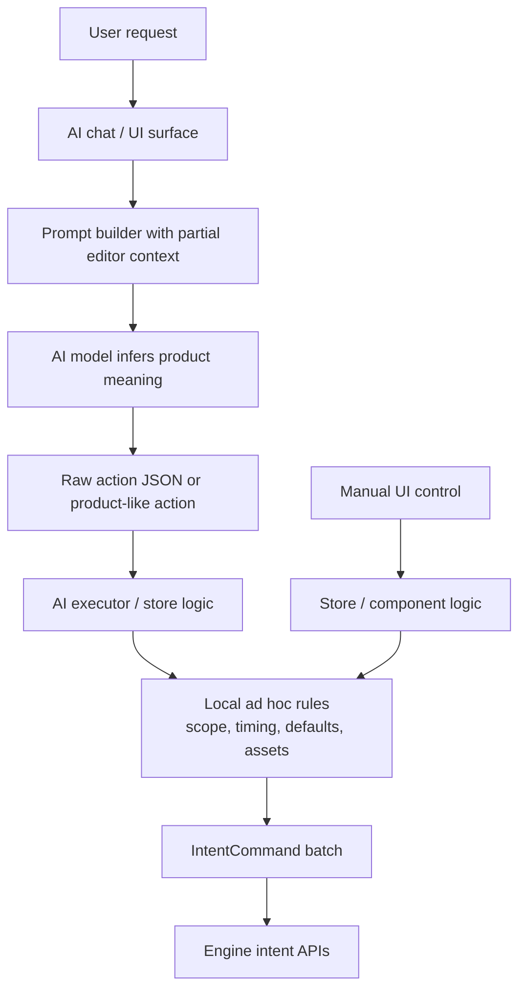
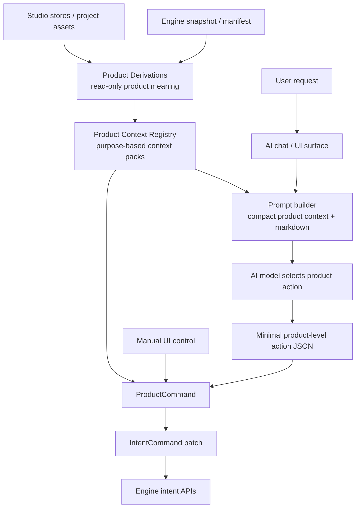

# ADR 002: Product Context And Command Promotion

[한국어](../ko/002-product-context-and-command-promotion.md)

- **Status**: Accepted
- **Date**: 2026-05-11
- **Context**: `desktop-studio` needs a predictable way to decide which AI and UI actions should become ProductCommands, and how AI should receive product-level context without interpreting raw engine manifests.

## Context

ADR 001 defines the boundary between engine-owned IntentCommands and Studio-owned ProductCommands. That boundary solves execution policy, but it leaves two follow-up questions:

- how Studio should derive product meaning from engine snapshots and manifests
- when a repeated IntentCommand pattern should be promoted into a ProductCommand

AI chat makes this more important. AI can sometimes infer a sequence of low-level actions from raw state, but that approach is expensive and brittle. A request like "put this image at the end" should not require the model to infer project duration, scope ids, scope roles, source URLs, fit defaults, and selection behavior from raw manifest shape.

Studio should compute those facts before prompting or executing, then expose a product-level summary and product-level command surface.

## AS-IS

Today, AI and UI entry points can still reach raw engine concepts too directly. Product interpretation is scattered across prompts, executor code, stores, and components.



Problems:

- AI must infer product facts that Studio can compute deterministically.
- Scope, timing, defaults, and asset resolution can be repeated in multiple places.
- Product-like AI actions may stay in parser or executor code instead of becoming reusable product APIs.
- Prompt context and command execution can drift because they do not share the same product derivations.

## Decision

`desktop-studio` will use three Studio-owned layers above engine state.

### Product Derivations

Product Derivations are pure read-side functions that translate engine and Studio state into product meaning.

Examples:

- project content end
- insertable scopes for an image, text, audio, or spectrum layer
- selected layer product context
- parent scope for a selected layer
- preferred scope for background vs overlay usage

These functions should not execute edits. They should read snapshots, manifests, Studio state, and project assets, then return stable product-shaped data.

### Product Context Registry

Product Context Registry means a single gateway for building purpose-specific context packs for AI, UI previews, and ProductCommands.

Examples of context pack purposes:

- image placement
- selected layer editing
- music video draft creation
- text/title insertion
- spectrum creation

A context pack may include:

- derived data, such as project end time or valid scope candidates
- available ProductCommands for that purpose
- short runtime markdown explaining when to use the capability
- constraints such as "do not invent scope ids" or "missing assets cannot be placed"

The AI prompt builder should prefer context packs over raw manifest dumps. AI should receive a compact product summary, not be asked to rediscover product rules from engine state.

## TO-BE

Studio should derive product context once, inject that context into AI prompts, and execute user-facing writes through ProductCommands.



The intended separation:

- Product Derivations answer "what does this engine state mean in Studio?"
- Product Context Registry answers "what compact context does this purpose need?"
- ProductCommands answer "how should this user-facing action execute safely?"
- IntentCommands remain the engine's atomic execution contract.

### ProductCommand Promotion

A ProductCommand should be added when a user-facing use case becomes common, important, or error-prone.

Promote an IntentCommand pattern into a ProductCommand when:

- users naturally ask for it in product language
- UI and AI entry points need the same behavior
- multiple call sites repeat the same IntentCommand sequence
- the action needs product policy such as scope, timing, defaults, fallback, validation, or selection behavior
- AI frequently needs to infer details that Studio can determine deterministically

Keep direct IntentCommand use when:

- the action is an atomic Inspector or slider edit
- the surface is developer/debug-only
- the product meaning is not stable yet
- the action is read-only or pure UI state

## Rules

- ProductCommands remain the write-side product API for user-facing actions.
- Product Derivations remain read-only and must not dispatch engine intents.
- Product Context Registry should be the main source for AI prompt context.
- AI should choose ProductCommands with minimal arguments, not assemble low-level engine manifests when a ProductCommand exists.
- IntentCommands are still the engine execution contract. ProductCommands compile into one or more IntentCommands.
- Repeated raw IntentCommand usage from AI paths is a migration signal.

## Example Flow

For "attach this image to the end for 7 seconds":

```text
1. Product Context Registry builds an image-placement context pack.
   - projectContentEnd: 24
   - valid scopes: main-scope, overlay-scope
   - instruction: use ADD_IMAGE_ASSET_TO_TIMELINE for image assets at the end

2. AI returns a compact product-level action.
   - assetId
   - placement: end
   - durationSeconds: 7
   - fit: cover

3. ProductCommand executes the action.
   - resolve asset source URL
   - resolve target scope
   - convert global time to scope-local start time
   - emit ADD_LAYER
```

The AI handles intent selection. Studio handles product interpretation. The engine receives deterministic IntentCommands.

## Consequences

- AI prompts become smaller and less dependent on raw manifest details.
- Scope id hallucination risk decreases because context packs provide valid candidates.
- Product behavior becomes easier to test outside the AI model.
- Frequently used user workflows become explicit product APIs.
- ProductCommand growth is controlled by actual use cases instead of mirroring every IntentCommand one-to-one.

## Initial Promotion Candidates

The first ProductCommand implementation is image asset placement.

Likely next candidates:

- create a music video draft from audio and image assets
- add a title text layer to the scene
- update selected layer transform using product language
- replace selected layer media
- add a spectrum layer connected to audio
- trim or extend selected layer timing
- remove selected layers with product-level confirmation policy
