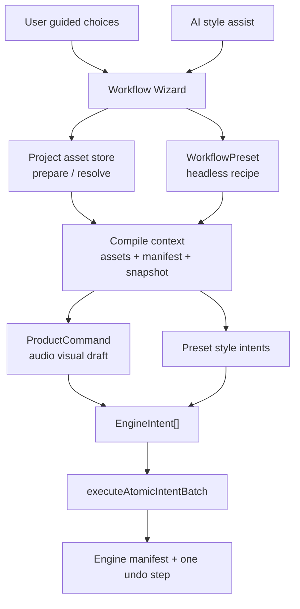

# ADR 003: Headless Workflow Layer

[한국어](../ko/003-headless-workflow-layer.md)

- **Status**: Accepted
- **Date**: 2026-05-12
- **Context**: `desktop-studio` needs a repeatable audio-visual draft creation flow that can be used by UI and AI without exposing node graphs or low-level engine intents to users.

## Context

ADR 001 defines ProductCommands as the Studio-owned command layer above engine intents. ADR 002 defines Product Context and ProductCommand promotion for AI and UI actions.

The audio-visual draft creation flow is larger than a single ProductCommand:

- choose or upload required assets
- select a production style
- set title and aspect ratio
- compile the selected recipe into deterministic engine edits
- apply all scene changes as one undoable action

This is also where the product position matters. Rendium should not require expensive video generation credits for the core loop. The reusable value should live in local workflow recipes and editable scene results.

## Decision

`desktop-studio` will add a Studio-owned **Headless Workflow** layer above ProductCommands.

Headless Workflow means:

- users do not see node graphs, DAGs, or intent lists
- UI and AI choose from product-level presets and parameters
- workflow compile produces deterministic `EngineIntent[]`
- final scene mutation goes through `engineStore.executeAtomicIntentBatch()`
- asset upload / selection is prepared before engine mutation and remains outside engine undo

The engine package is not changed for v1. `@rendium/engine` already provides the needed atomic execution contract through `executeAtomicIntentBatch()` and transaction-backed history.

## TO-BE

## Rules

- Headless workflows live in `desktop-studio`, not `@rendium/engine`.
- Workflows may call ProductCommand resolvers or produce simple style patch intents.
- Workflows must not mutate engine state during compile.
- Compile failures must be returned before `executeAtomicIntentBatch()` is called.
- A successful workflow apply should be one history entry.
- Asset upload and project asset persistence remain outside engine undo.
- AI can suggest preset parameters, but final apply must use the same deterministic workflow path as manual UI.

## Initial Implementation

The first workflow is the audio-visual-draft workflow:

- `basic-music-visualizer`
- `cover-spectrum-title`
- `shorts-teaser`

Each preset requires audio and image assets. The compile step delegates the base draft to the existing audio-visual draft ProductCommand, then appends preset-specific style intents such as canvas size, spectrum gain, image fit, and title size.

## Consequences

- UI and AI can share a single deterministic audio-visual draft creation path.
- The product can add new presets without adding user-facing node UI.
- Undo remains simple because the engine only sees one atomic intent batch.
- Future visual node editor work can build on preset contracts without becoming a v1 dependency.
- The workflow layer must stay thin; if a recipe becomes generally useful, its policy should move into a ProductCommand.
