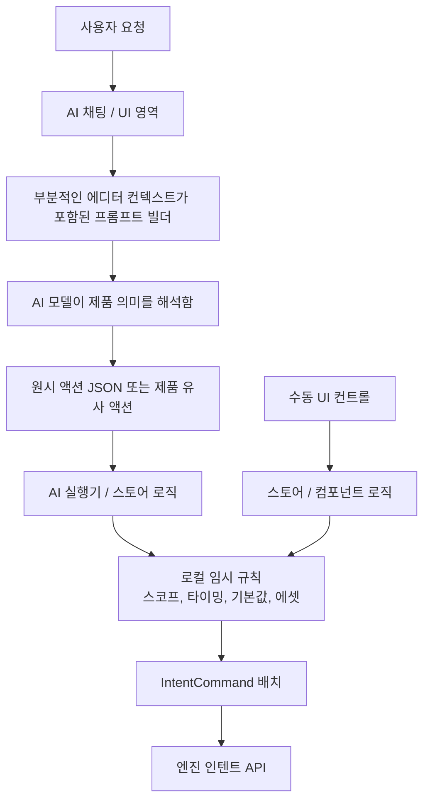
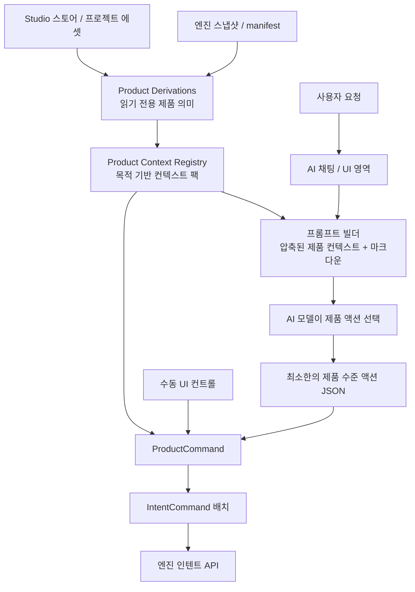

# ADR 002: Product Context And Command Promotion (제품 컨텍스트 및 명령 승격)

[English](../en/002-product-context-and-command-promotion.md)

- **상태**: 승인됨
- **날짜**: 2026-05-11
- **맥락**: `desktop-studio`는 어떤 AI 및 UI 액션을 ProductCommand로 승격할지 결정하는 예측 가능한 방법과, AI가 원시 엔진 manifest를 직접 해석하지 않고 제품 수준의 컨텍스트를 수신하도록 하는 방법이 필요합니다.

## 맥락

ADR 001에서는 엔진 소유의 IntentCommand와 Studio 소유의 ProductCommand 사이의 경계를 정의했습니다. 이 경계는 실행 정책 문제를 해결하지만, 다음과 같은 후속 질문을 남깁니다:
- Studio가 엔진 스냅샷과 manifest로부터 제품 의미를 어떻게 도출해야 하는가
- 반복되는 IntentCommand 패턴을 언제 ProductCommand로 승격해야 하는가

AI 채팅으로 인해 이 사안이 더욱 중요해졌습니다. AI는 때때로 원시 상태로부터 저수준 액션의 시퀀스를 유도해낼 수 있지만, 이 방식은 비용이 많이 들고 불안정합니다. "이 이미지를 끝부분에 추가해줘"라는 요청을 처리하기 위해 AI 모델이 원시 manifest 형태로부터 프로젝트 총 재생 시간, 스코프 ID, 스코프 역할, 소스 URL, 기본 맞춤(fit) 값, 선택 동작 등을 스스로 알아내야 해서는 안 됩니다.

Studio는 프롬프트를 구성하거나 실행하기 전에 이러한 팩트들을 먼저 결정론적으로 계산한 다음, 제품 수준의 요약(summary) 및 제품 수준의 명령 인터페이스를 노출해야 합니다.

## 기존 방식 (AS-IS)

현재 AI 및 UI 진입점은 여전히 원시 엔진 개념에 너무 직접적으로 접근할 수 있습니다. 제품 관점의 해석이 프롬프트, 실행기 코드, 스토어, 컴포넌트 전반에 흩어져 있습니다.



문제점:
- AI는 Studio가 결정론적으로 계산할 수 있는 제품 정보들을 스스로 유도해야 합니다.
- 스코프, 타이밍, 기본값, 에셋 해석 등이 여러 곳에서 중복되어 나타날 수 있습니다.
- 제품 레이어에 적합한 AI 액션들이 재사용 가능한 제품 API가 되지 못하고 파서나 실행기 코드 내부에 방치될 수 있습니다.
- 프롬프트 컨텍스트와 명령 실행이 동일한 제품 유도(derivation) 방식을 공유하지 않아 서로 괴리가 발생할 수 있습니다.

## 결정 사항

`desktop-studio`는 엔진 상태 위에 세 개의 Studio 소유 레이어를 도입합니다.

### Product Derivations (제품 유도)

Product Derivations는 엔진 및 Studio 상태를 읽어서 제품 의미로 변환하는 순수 읽기 전용 함수들입니다.

예시:
- 프로젝트 콘텐츠의 끝 시점
- 이미지, 텍스트, 오디오, 또는 스펙트럼 레이어를 삽입할 수 있는 스코프 목록
- 선택된 레이어의 제품 컨텍스트
- 선택된 레이어의 부모 스코프
- 배경(background) vs 오버레이(overlay) 사용을 위한 선호 스코프

이 함수들은 편집을 실행해서는 안 됩니다. 이들은 스냅샷, manifest, Studio 상태, 프로젝트 에셋을 읽고 안정적인 제품 형태의 데이터를 반환해야 합니다.

### Product Context Registry (제품 컨텍스트 레지스트리)

Product Context Registry는 AI, UI 프리뷰 및 ProductCommand를 위한 목적별 컨텍스트 팩(context pack)을 구축하기 위한 단일 게이트웨이를 의미합니다.

컨텍스트 팩 목적의 예시:
- 이미지 배치
- 선택된 레이어 편집
- 뮤직비디오 초안 생성
- 텍스트/타이틀 삽입
- 스펙트럼 생성

컨텍스트 팩에는 다음 사항이 포함될 수 있습니다:
- 프로젝트 종료 시간 또는 유효한 대상 스코프와 같은 유도 데이터
- 해당 목적에 사용 가능한 ProductCommand
- 기능 사용 시기를 설명하는 런타임용 짧은 마크다운 가이드
- "존재하지 않는 스코프 ID를 지어내지 말 것", "누락된 에셋은 배치할 수 없음"과 같은 제약 조건

AI 프롬프트 빌더는 원시 manifest 덤프 대신 컨텍스트 팩을 선호해야 합니다. AI는 엔진 상태로부터 제품 규칙을 다시 찾아내라는 요구를 받지 않고, 압축된 제품 요약 정보를 받아야 합니다.

## 개선 방향 (TO-BE)

Studio는 제품 컨텍스트를 한 번 유도하고, 이 컨텍스트를 AI 프롬프트에 주입하며, 사용자 대면의 쓰기 작업은 ProductCommand를 통해 실행합니다.



의도된 경계 분리:
- Product Derivations는 "이 엔진 상태가 Studio에서 무엇을 의미하는가?"에 답합니다.
- Product Context Registry는 "이 목적을 위해 어떤 압축된 컨텍스트가 필요한가?"에 답합니다.
- ProductCommand는 "이 사용자 대면 액션을 어떻게 안전하게 실행할 것인가?"에 답합니다.
- IntentCommand는 여전히 엔진의 원자적 실행 규약으로 남습니다.

### ProductCommand 승격 (Promotion)

사용자 대면 유스케이스가 자주 쓰이거나, 중요하거나, 오류가 발생하기 쉬울 때 ProductCommand를 추가해야 합니다.

다음의 경우 IntentCommand 패턴을 ProductCommand로 승격하십시오:
- 사용자가 자연스럽게 제품 언어로 그것을 요구할 때
- UI와 AI 진입점이 동일한 동작을 공유해야 할 때
- 여러 호출부에서 동일한 IntentCommand 시퀀스를 반복할 때
- 액션에 스코프, 타이밍, 기본값, 폴백, 검증 또는 선택 동작과 같은 제품 정책이 필요할 때
- AI가 Studio 측에서 결정론적으로 도출할 수 있는 세부사항을 빈번하게 추론해야 할 때

다음의 경우 IntentCommand의 직접 사용을 유지하십시오:
- 액션이 원자적인 인스펙터(Inspector) 에디트나 슬라이더 수정일 때
- 해당 영역이 개발자/디버그 전용일 때
- 제품 의미가 아직 안정되지 않았을 때
- 액션이 읽기 전용이거나 순수 UI 상태일 때

## 규칙

- ProductCommand는 사용자 대면 액션을 위한 쓰기 측 제품 API로 작동합니다.
- Product Derivations는 읽기 전용으로 유지되어야 하며 엔진 인텐트를 디스패치해서는 안 됩니다.
- Product Context Registry는 AI 프롬프트 컨텍스트의 주요 원천이 되어야 합니다.
- AI는 ProductCommand가 존재할 때 저수준 엔진 manifest를 조립하는 대신 최소한의 인자로 ProductCommand를 선택해야 합니다.
- IntentCommand는 여전히 엔진 실행 규약입니다. ProductCommand는 하나 이상의 IntentCommand로 컴파일됩니다.
- AI 경로에서 원시 IntentCommand가 반복 사용되는 것은 마이그레이션이 필요하다는 신호입니다.

## 예시 흐름

"이 이미지를 끝부분에 7초 동안 붙여줘"의 경우:

```text
1. Product Context Registry가 이미지 배치 컨텍스트 팩을 작성합니다.
   - projectContentEnd: 24
   - 유효한 스코프: main-scope, overlay-scope
   - 지침: 이미지 에셋을 끝에 추가하려면 ADD_IMAGE_ASSET_TO_TIMELINE을 사용하세요.

2. AI가 압축된 제품 수준 액션을 반환합니다.
   - assetId
   - placement: end
   - durationSeconds: 7
   - fit: cover

3. ProductCommand가 해당 액션을 실행합니다.
   - 에셋 소스 URL 해석
   - 대상 스코프 해석
   - 전역 시간을 스코프 로컬 시작 시간으로 변환
   - ADD_LAYER 발행
```

AI는 인텐트 선택을 처리하고, Studio는 제품 관점의 해석을 처리하며, 엔진은 결정론적인 IntentCommand를 수신합니다.

## 결과 및 영향

- AI 프롬프트가 더 작아지고 원시 manifest 세부사항에 덜 의존하게 됩니다.
- 컨텍스트 팩이 유효한 후보를 제공하므로 스코프 ID 환각(hallucination) 리스크가 감소합니다.
- 제품 동작을 AI 모델 외부에서 더 쉽게 테스트할 수 있습니다.
- 빈번하게 사용되는 사용자 워크플로우가 명시적인 제품 API가 됩니다.
- ProductCommand의 증가는 모든 IntentCommand를 1:1로 미러링하는 대신 실제 유스케이스에 의해 통제됩니다.

## 초기 승격 대상 후보

최초의 ProductCommand 구현은 이미지 에셋 배치입니다.

향후 예상 후보:
- 오디오 및 이미지 에셋으로부터 뮤직비디오 초안 생성
- 씬에 타이틀 텍스트 레이어 추가
- 제품 언어를 사용하여 선택된 레이어의 transform 업데이트
- 선택된 레이어의 미디어 교체
- 오디오에 연결된 스펙트럼 레이어 추가
- 선택된 레이어 타이밍의 트림(trim) 또는 확장
- 제품 수준의 확인 정책을 적용한 선택 레이어 제거
