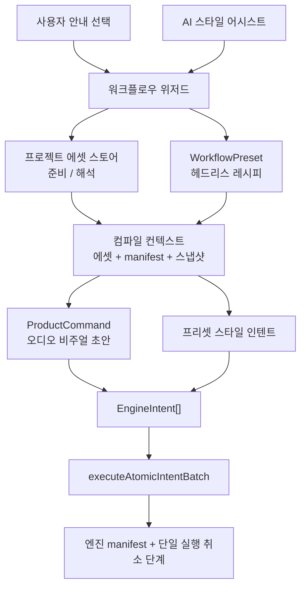

# ADR 003: Headless Workflow Layer (헤드리스 워크플로우 레이어)

[English](../en/003-headless-workflow-layer.md)

- **상태**: 승인됨
- **날짜**: 2026-05-12
- **맥락**: `desktop-studio`는 노드 그래프나 저수준 엔진 인텐트를 사용자에게 노출하지 않으면서, UI와 AI가 모두 사용할 수 있는 반복 가능한 오디오 비주얼 초안(draft) 생성 플로우가 필요합니다.

## 맥락

ADR 001은 엔진 인텐트 위에 Studio 소유의 명령 레이어로 ProductCommand를 정의했습니다. ADR 002는 AI 및 UI 액션을 위한 제품 컨텍스트와 ProductCommand 승격을 정의했습니다.

오디오 비주얼 초안 생성 플로우는 단일 ProductCommand보다 큽니다:
- 필요한 에셋을 선택하거나 업로드
- 제작 스타일(production style) 선택
- 제목(title) 및 종횡비(aspect ratio) 설정
- 선택된 레시피(recipe)를 결정론적인 엔진 편집 단위로 컴파일
- 모든 씬 변경 사항을 단일 실행 취소 가능 액션(undoable action)으로 적용

이것은 또한 제품의 비즈니스적 포지션과도 관련이 있습니다. Rendium은 코어 루프에 비싼 비디오 생성 크레딧을 요구해서는 안 됩니다. 재사용 가능한 가치는 로컬 워크플로우 레시피와 편집 가능한 씬 결과물에 귀속되어야 합니다.

## 결정 사항

`desktop-studio`는 ProductCommand 위에 Studio 소유의 **Headless Workflow (헤드리스 워크플로우)** 레이어를 추가합니다.

Headless Workflow의 의미:
- 사용자는 노드 그래프, DAG 또는 인텐트 목록을 보지 못합니다.
- UI와 AI는 제품 수준의 프리셋 및 파라미터 내에서 선택합니다.
- 워크플로우 컴파일은 결정론적인 `EngineIntent[]`를 생성합니다.
- 최종 씬 변이는 `engineStore.executeAtomicIntentBatch()`를 통해 처리됩니다.
- 에셋 업로드 / 선택은 엔진 변이 이전에 준비되며, 엔진 실행 취소 범위 밖에 존재합니다.

엔진 패키지는 v1에서 수정되지 않습니다. `@rendium/engine`은 이미 `executeAtomicIntentBatch()` 및 트랜잭션 기반 히스토리를 통해 필요한 원자적 실행 규약을 제공하고 있습니다.

## 개선 방향 (TO-BE)

## 규칙

- 헤드리스 워크플로우는 `@rendium/engine`이 아닌 `desktop-studio`에 위치합니다.
- 워크플로우는 ProductCommand 리졸버를 호출하거나 간단한 스타일 패치 인텐트를 생성할 수 있습니다.
- 워크플로우는 컴파일 도중 엔진 상태를 직접 변경해서는 안 됩니다.
- 컴파일 실패는 `executeAtomicIntentBatch()`가 호출되기 전에 먼저 반환되어야 합니다.
- 성공적인 워크플로우 적용은 히스토리 상에서 단일 항목으로 기록되어야 합니다.
- 에셋 업로드 및 프로젝트 에셋 영속성은 엔진 실행 취소 외부에 남아 있습니다.
- AI가 프리셋 파라미터를 제안할 수는 있으나, 최종 적용은 수동 UI와 동일한 결정론적 워크플로우 경로를 거쳐야 합니다.

## 초기 구현

최초의 워크플로우는 오디오 비주얼 초안 워크플로우입니다:
- `basic-music-visualizer` (기본 뮤직 비주얼라이저)
- `cover-spectrum-title` (커버 스펙트럼 타이틀)
- `shorts-teaser` (쇼츠 티저)

각 프리셋은 오디오 및 이미지 에셋을 필요로 합니다. 컴파일 단계는 베이스 초안을 기존 오디오 비주얼 초안 ProductCommand에 위임한 후, 캔버스 크기, 스펙트럼 게인, 이미지 맞춤, 타이틀 크기와 같은 프리셋별 스타일 인텐트를 덧붙입니다.

## 결과 및 영향

- UI와 AI가 단일한 결정론적 오디오 비주얼 초안 생성 경로를 공유할 수 있습니다.
- 제품은 사용자 대면 노드 UI를 추가하지 않고도 새로운 프리셋을 추가할 수 있습니다.
- 엔진이 하나의 원자적 인텐트 배치만 수신하므로 실행 취소(Undo)가 단순하게 유지됩니다.
- 향후 비주얼 노드 에디터 작업 시 v1 의존성 없이 프리셋 규약을 기반으로 빌드할 수 있습니다.
- 워크플로우 레이어는 얇게 유지되어야 합니다. 만약 레시피가 일반적으로 널리 유용해진다면 그 정책은 ProductCommand로 이관되어야 합니다.
