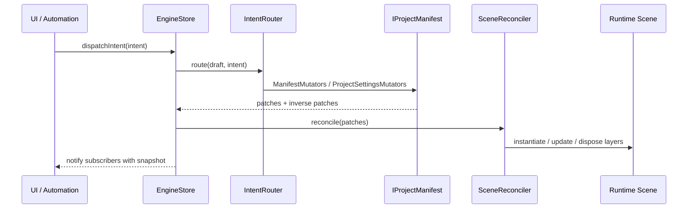
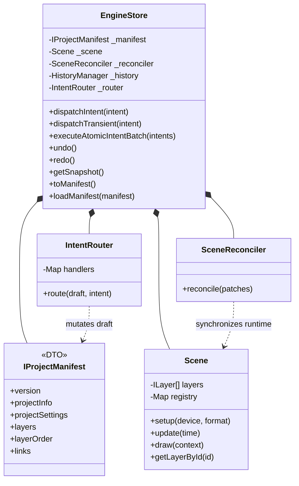

# @rendium/engine

[English](./README.md) | 한국어

`@rendium/engine`은 Rendium workspace의 WebGPU 기반 편집 엔진입니다. 현재 구현의 중심은 `IProjectManifest` 단일 진실 공급원, intent 기반 mutation API, JSON patch 기반 runtime reconciliation입니다.

이 패키지를 수정하기 전에 `packages/rendium-engine/.agentrules.yml`에 선언된 `required_reading` 문서들을 먼저 읽는 것을 전제로 합니다.

## 핵심 아키텍처

- **Intent-Driven API**: UI와 자동화 계층은 `EngineIntent`를 만들고 `engineStore.dispatchIntent()`로 전달합니다.
- **Immutable Manifest**: canonical state is `IProjectManifest`이며 `projectInfo`, `projectSettings`, `layers`, `layerOrder`, `links`로 정규화됩니다.
- **Patch-Based Sync**: manifest 변경은 Immer patch로 기록되고 `SceneReconciler`가 runtime `Scene`에 반영합니다.
- **Unified Flat Architecture**: scope는 중첩 트리가 아니라 `scopeStart` / `scopeEnd` control marker와 `layerOrder`로 표현합니다.
- **Atomic Undo/Redo**: `executeAtomicIntentBatch()`와 transaction API가 여러 intent를 하나의 history record로 묶습니다.

상세 사용 예시는 [USAGE.ko.md](./USAGE.ko.md)를, 레이어/manifest 작업 전 최신 규칙은 [_docs/onboarding](./_docs/onboarding)을 먼저 확인하세요.

## 아키텍처 결정 기록 (ADRs)

Rendium의 설계 역사를 파악하려면 다음 문서를 참조하세요:
- [루트 아키텍처 결정 기록 (ADR-001 ~ 005)](../../_docs/architecture-decisions/ko)
- [코어 엔진 아키텍처 결정 기록 (ADR-001 ~ 011)](./_docs/history-architecture/ko)
- [데스크톱 스튜디오 아키텍처 결정 기록 (ADR-001 ~ 005)](../../apps/desktop-studio/_docs/history-architecture/ko)

## 모듈 구조

- `src/_contracts`: manifest, layer, intent, error 등 public contract.
- `src/store`: `EngineStore`, `IntentRouter`, history, manifest mutator, selector, project factory.
- `src/timeline`: scene bootstrap, validation, reconciliation.
- `src/core`: runtime `Scene`, audio manager, render state stack.
- `src/layers`: audio, visual, scope marker runtime layer와 drawable provider.
- `src/_utils`: transform, matrix, time, validation helper.

## 공개 인터페이스 (Public Surface)

```typescript
import {
  AudioManager,
  EngineSelectors,
  engineStore,
  type EngineIntent,
  type ILayerManifest,
  type IProjectManifest,
} from '@rendium/engine';
```

주 mutation API는 `engineStore.dispatchIntent(intent)`이며, 복합 작업은 `executeAtomicIntentBatch()`를 사용합니다. 둘은 단건 처리와 원자적 배치 처리를 분리해 API를 단순하게 유지합니다.

## 아키텍처 흐름 (Architecture Flow)



## 컴포넌트 맵 (Component Map)



## 검증 (Verification)

패키지 범위의 검증을 먼저 사용하십시오:

```bash
pnpm --filter @rendium/engine test
pnpm --filter @rendium/engine build
```

로컬 패키지 스크립트가 워크스페이스 래퍼로 포워딩하므로 이 패키지에서도 `pnpm agent`가 작동합니다.

공유 계약 또는 워크스페이스 레벨 변경 사항에 대해서는 루트 `AGENTS.md`에 설명된 워크스페이스 검증 경로로 확장하십시오.

## 라이선스 (License)

이 패키지는 Rendium 모노레포 내부 비공개 패키지입니다.
