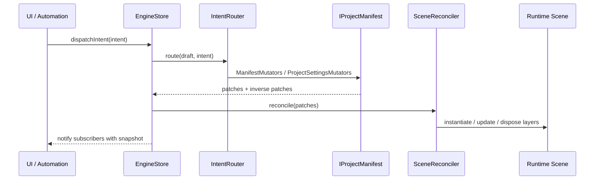
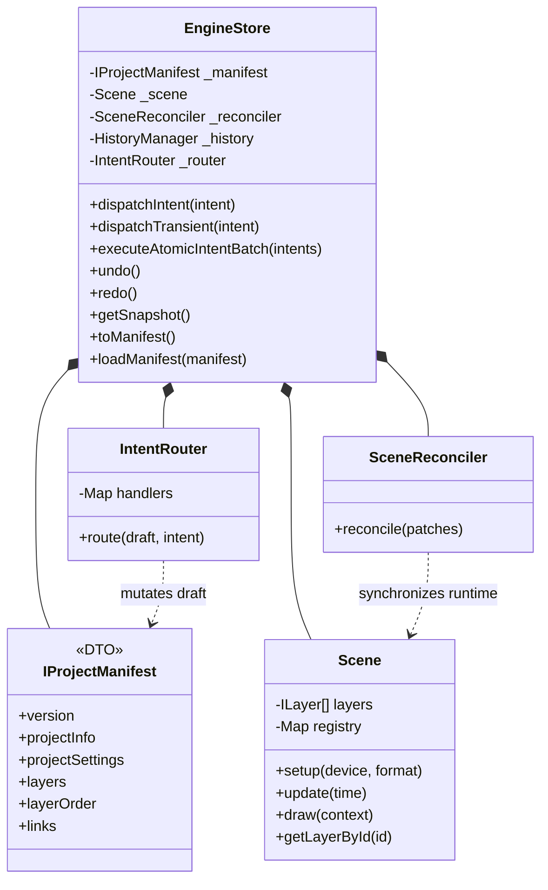

# @rendium/engine

English | [한국어](./README.ko.md)

`@rendium/engine` is the WebGPU-based editing engine of the Rendium workspace. The core of the current implementation revolves around the `IProjectManifest` Single Source of Truth, the intent-driven mutation API, and JSON patch-based runtime reconciliation.

Before modifying this package, you must read the `required_reading` documents declared in `packages/rendium-engine/.agentrules.yml`.

## Core Architecture

- **Intent-Driven API**: UI and automation layers construct an `EngineIntent` and send it to the engine via `engineStore.dispatchIntent()`.
- **Immutable Manifest**: The canonical state is `IProjectManifest`, normalized into `projectInfo`, `projectSettings`, `layers`, `layerOrder`, and `links`.
- **Patch-Based Sync**: Manifest changes are recorded as Immer patches and synchronized to the runtime `Scene` by the `SceneReconciler`.
- **Unified Flat Architecture**: Scopes are represented as flat `scopeStart` / `scopeEnd` control markers inside the `layerOrder` instead of nested trees.
- **Atomic Undo/Redo**: `executeAtomicIntentBatch()` and the transaction API group multiple intents into a single history record.

For detailed usage, refer to [USAGE.md](./USAGE.md). For the latest rules before working on layers/manifests, check [_docs/onboarding](./_docs/onboarding).

## Architecture Decisions (ADRs)

To understand the design history of Rendium, refer to the following documents:
- [Root Architecture Decisions (ADR-001 ~ 005)](../../_docs/architecture-decisions/en)
- [Core Engine Architecture Decisions (ADR-001 ~ 011)](./_docs/history-architecture/en)
- [Desktop Studio Architecture Decisions (ADR-001 ~ 005)](../../apps/desktop-studio/_docs/history-architecture/en)

## Module Structure

- `src/_contracts`: Public contracts such as manifest, layer, intent, and error definitions.
- `src/store`: `EngineStore`, `IntentRouter`, history, manifest mutators, selectors, and the project factory.
- `src/timeline`: Scene bootstrap, validation, and reconciliation.
- `src/core`: Runtime `Scene`, audio manager, and render state stack.
- `src/layers`: Audio, visual, and scope marker runtime layers along with drawable providers.
- `src/_utils`: Transform, matrix, time, and validation helpers.

## Public Surface

```typescript
import {
  AudioManager,
  EngineSelectors,
  engineStore,
  type EngineIntent,
  type ILayerManifest,
  type IProjectManifest,
} from '@rendium/engine';
```

The main mutation API is `engineStore.dispatchIntent(intent)`. For compound operations, use `executeAtomicIntentBatch()`. They are separated to keep the API simple.

## Architecture Flow



## Component Map



## Verification

Use the package-local checks first:

```bash
pnpm --filter @rendium/engine test
pnpm --filter @rendium/engine build
```

The `pnpm agent` script works inside this package as it forwards to the workspace wrapper.

For shared contracts or workspace-level changes, expand to the workspace verification path described in the root `AGENTS.md`.

## License

This package is private to the Rendium monorepo.
