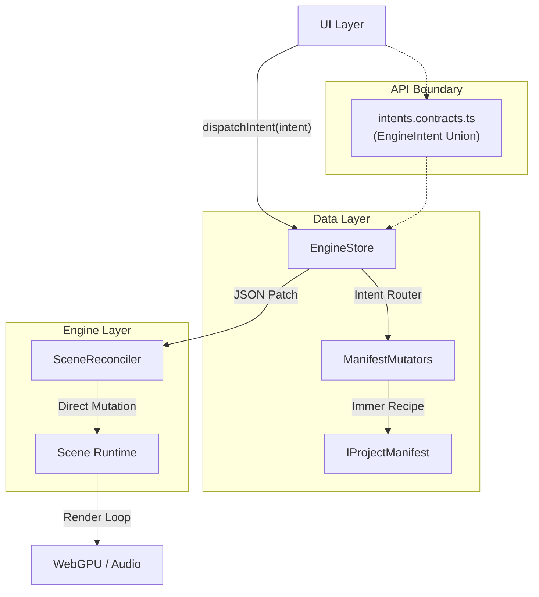
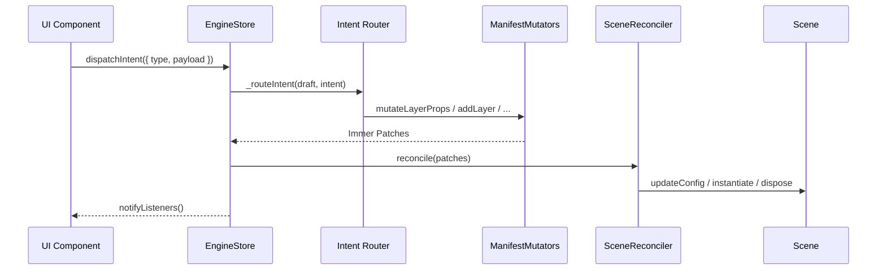
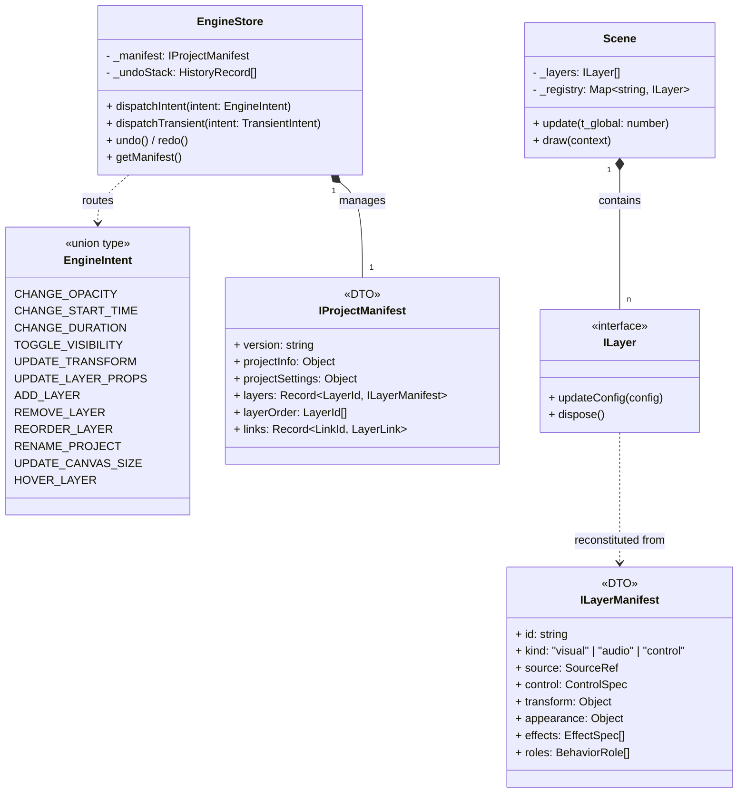
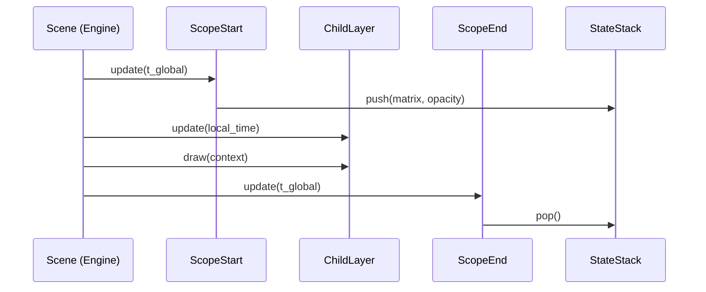

# Rendium Engine Technical Documentation

[한국어](../ko/ARCHITECTURE.md)

This document describes the architecture and implementation specifications of **Rendium, a WebGPU-based high-performance non-linear editing (NLE) engine**.

## 0. AI Onboarding Entry Points

Read all documents in `_docs/onboarding` before modifying the layer model, manifest structure, runtime factory, or visual render path.
- `onboarding/README.md`: Document reading order and priorities.
- `onboarding/core-layer-onboarding.md`: Explains core layer contracts, manifests, runtime factories, scope/link policies, and AI checklists.
- `onboarding/visual-layer-provider-onboarding.md`: Extension rules for `VisualLayer + DrawableProvider`.

Onboarding documents take precedence for active implementation. The `history-architecture` directory contains historical decision records and is not the source of truth for current implementation rules.

---

## 1. Design Philosophy & Architectural Overview

### 1.1 Single Source of Truth (SSOT): Immutable Manifest
Rendium strictly separates the runtime engine (Scene) from the state manager (Store). The single source of truth is a pure JSON object named **`IProjectManifest`**, and the engine acts as a **Passive View** reflecting this manifest.
- **Normalized Project DTO**: The manifest is normalized into `projectInfo`, `projectSettings`, `layers`, `layerOrder`, and `links`.
- **Immutability**: All state modifications are controlled via `EngineStore` using immutability principles.
- **Patch-based Sync**: State changes generate **JSON Patches**, providing $O(1)$ synchronization efficiency and enabling complete Undo/Redo tracking.

### 1.2 Intent-Driven Architecture
To completely decouple the UI layer from engine internals, Rendium adopts the **Intent-Driven Pattern**:
- **Contract**: Every allowed action is defined as a union type under `EngineIntent` (`_contracts/intents.contracts.ts`).
- **Passive View**: UI components only specify *what* they intend to do, leaving *how* to modify state to the engine.
- **Executable Specification**: The TypeScript compiler acts as the validator, using the intent interfaces as self-documenting specifications.
- **Automation Ready**: Automation macros or AI agents can emulate 100% of user editing actions by passing an array of intent objects to the engine.

### 1.3 Unified Flat Architecture
The engine core rendering layer preserves a flat data structure to optimize performance:
- **Bracket Structure**: Control layers (`kind: "control"`, `control.role: "scopeStart" | "scopeEnd"`) are stored as flat layers but interpreted semantically as structure markers.
- **Derived Sequence**: A `Sequence` is a logical wrapper computed on top of `layers + layerOrder` rather than being a separate database entity.
- **Performance**: Eliminating recursive calls and using flat $O(n)$ iteration loops maximizes CPU cache efficiency during rendering.

### 1.4 Project Info / Project Settings / Timeline Boundary
Global properties that do not depend on the timeline are managed as project-level fields in `IProjectManifest` rather than layers.
- **Project Info**: Document identity details such as name, creation time, and modification time are held in `projectInfo`.
- **Project Settings**: Global canvas, background, watermark, export range, and work area configurations are owned by `projectSettings`.
- **Background Rendering**: The canvas background is rendered via the render pass's `clearValue` or surface settings, avoiding dedicated background layers.
- **Temporal Content Only**: Only objects with `startTime` and `duration` remain as timeline layers. Full-screen visual elements are still layers if they depend on the time axis.
- **Legacy Cleanup**: The legacy background layer has been deleted, and background settings are edited directly through `projectSettings`.

---

## 2. Engine System Architecture

### 2.1 Architecture Diagram (Intent-Driven Flow)



### 2.2 Intent Sequence Diagram



### 2.3 Class Diagram (Component Composition)



---

## 3. State Management & Synchronization Mechanism

### 3.1 Normalized State Shape
For data integrity and patch efficiency, `IProjectManifest` adopts the following structure:
- **Project Info**: `projectInfo` contains only document identity values.
- **Project Settings**: `projectSettings` contains canvas, output, background, and work area configurations.
- **Selector Boundary**: `EngineSelectors` focuses on the UI snapshot and viewport calculations, while `SequenceBoundsService` handles sequence bounds, parent resolution, and insertion context derivations.
- **`layers` (Record)**: A layer property store indexed by ID. This ensures that adding or deleting layers does not affect the patch path of other layers.
- **`layerOrder` (Array)**: The sole array determining the rendering and layer order.
- **Derived Structure**: Sequence bounds, parent sequences, and insertion contexts are calculated dynamically instead of being persisted.

### 3.2 Intent-Driven Dispatch
UI components do not need to know the engine's internal structure (Immer drafts, `ManifestMutators`). They only dispatch pure JSON Intent objects.

```typescript
// Dispatched from UI (Only specifies "What")
dispatchIntent({ type: 'CHANGE_OPACITY', layerId: 'abc', opacity: 0.5 });

// Handled internally (Intent Router determines "How")
// -> mutateLayerProps(draft, 'abc', l => { l.appearance.opacity = 0.5 })
```

Supported Intent Types:
| Category | Intent Types |
| --- | --- |
| Layer Properties | `CHANGE_OPACITY`, `CHANGE_START_TIME`, `CHANGE_DURATION`, `TOGGLE_VISIBILITY`, `UPDATE_TRANSFORM`, `UPDATE_LAYER_PROPS` |
| Layer Lifecycle | `ADD_LAYER`, `REMOVE_LAYER`, `REORDER_LAYER` |
| Project | `RENAME_PROJECT`, `UPDATE_CANVAS_SIZE` |
| UI-Only | `HOVER_LAYER` |
| Transient | `TRANSIENT_LAYER_UPDATE` (separated union) |

### 3.3 SceneReconciler
Interprets JSON Patches generated by `EngineStore` and applies them to the runtime engine.
- **O(1) Access**: Directly locates and updates runtime instances in the engine registry using the ID from the patch path.
- **Resource Management**: The Reconciler always calls `dispose()` when a layer is removed to prevent GPU/Audio resource leaks.

### 3.4 Draft-Commit Pattern
To maintain performance during high-frequency interactions (such as mouse drags), updates are performed in two stages:
1. **Transient Update**: Updates the runtime engine instances directly via `dispatchTransient({ type: 'TRANSIENT_LAYER_UPDATE', layerId, partial })` (does not generate patches or history records).
2. **Commit**: Dispatches `dispatchIntent()` once the interaction ends to write the final state to the store and create a history snapshot.

---

## 4. Rendering and Time System

### 4.1 Stack-based Execution Sequence
The rendering loop traverses the flat array sequentially and propagates attributes using an internal evaluation stack.



### 4.2 Temporal Hierarchy
All sub-elements operate in a relative temporal coordinate system where the parent's start time is treated as 0.
$$t_{local, i} = t_{parent} - startTime_{i}$$

---

## 5. Technical Specifications
- **Coordinate System**: 1920x1080 logical pixel space.
- **WebGPU Alignment**: Complies with the 256-byte alignment requirement for uniform buffers.
- **Audio Pipeline**: Lifecycle management based on asynchronous loading and `AbortController`.
- **API Boundary**: `intents.contracts.ts` is the sole contract boundary between the UI and the Engine.
- **Canvas Background**: The project background is managed via a clear step using `projectSettings.canvas.backgroundColor` rather than a dedicated layer.

---

## 6. Architectural History

### 6.1 Global Canvas Attributes Migration
The decision to separate the background and global canvas attributes from layers is documented in:
- [ADR 007: Global Canvas Attributes Migration](../history-architecture/en/007-global-canvas-attributes-migration.md)

### 6.2 Project Info / Settings and Sequence Bounds Cleanup
The decisions to consolidate global fields into `projectInfo` / `projectSettings` and move sequence interpretation to `SequenceBoundsService` are documented in:
- [ADR 008: Project Info, Settings, and Sequence Bounds Refactor](../history-architecture/en/008-project-info-settings-sequence-bounds-refactor.md)
