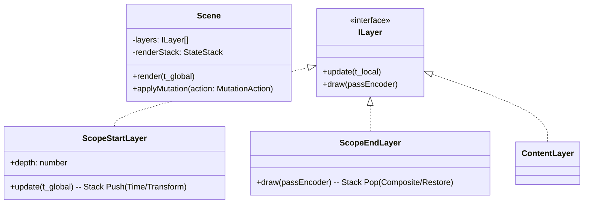

# ADR 002: Announcement of Unified Flat Architecture Decision

[한국어](../ko/002-unified-flat-architecture.md)

## Context
During the initial build of the rendering engine (Rendium), we designed a **"Hybrid Flat Structure (1D Array + Markers)"** as an optimization structure to solve the **layer state management bottleneck at the "Scope" (formerly Group) level**. We needed clear design standards for state synchronization between the engine (Core) and studio (UI), layer manipulation stability, multi-pass effect execution, and seeking optimization.

## Decision
After reviewing the proposed issues, we decided to officially adopt a **"Unified Flat" structure where Data, Studio (UI), and Core (Engine) all share a single 1D array**.

### 1. State Model: "No Separated Trees (Single Source of Truth)"
* **Decision:** We do not manage a separate tree structure for the UI. The 1D array itself, which includes bracket (`ScopeStart`/`ScopeEnd`) markers, is the only source of truth for the entire application.
* **Rationale:** This is to prevent architectural redundancy, synchronization overhead, and integrity issues between tree models and flat arrays. The UI renders a **"Bracket UI (indentation guide)"** based on the `depth` information of the flat array elements to provide an intuitive hierarchical interface to the user.

### 2. Layer Mutations: "Atomic Mutations"
* **Decision:** We introduce a `SceneMutator` (or a dedicated class/reducer) to encapsulate array operations at the framework level.
* **Mechanism:** When inserting, resizing, or moving layers/scopes, the entire `[ScopeStart, ...children, ScopeEnd]` block is treated as a single **Atomic Unit** for `splice` operations. This acts as a strong safeguard to prevent the rendering pipeline from collapsing due to mismatched brackets.

### 3. Multi-pass Rendering: "Stack-based State Transition"
* **Decision:** Implement `ScopeStart` and `ScopeEnd` to directly manage the lifecycle of WebGPU Render Passes.
* **Mechanism:** When applying scope-level properties (such as post-processing effects like opacity, blur, etc.), the engine switches the render pass to a temporary offscreen texture (framebuffer) at `ScopeStart`. At the `ScopeEnd` stage, where the state stack (`StateStack`) is popped, it composites the temporary output back to the parent pass.

### 4. Performance Optimization: "Deferred Optimization"
* **Decision:** In the initial phase, we maintain a sequential $O(n)$ search loop over the array without separate spatial-temporal partitioning (such as an Interval Tree).
* **Rationale:** We avoid premature optimization. In a WebGPU environment, securing data consistency and design simplicity is far more important than the V8 engine's overhead in iterating over a 1D array. We leave the engine's internal interfaces open for expansion so that interval indexing can be introduced later if the number of layers exceeds thousands and causes a bottleneck.

## Consequences and Benefits
1. **Single Source of Truth Secured:** Eliminates bugs where the renderer and UI state drift due to missing state synchronization.
2. **Integrity Rendering Pipeline:** Since the integrity of the bracket structure is strictly guaranteed by the `SceneMutator`, it provides a solid foundation for robust Undo/Redo features.
3. **Improved Readability and Maintainability:** The engine core is structured as an intuitive stack-based loop without excessive optimization logic, making it easy to understand when extending the system (e.g., adding new layers or effects).

---

### Finalized Class Structure (Mermaid)

