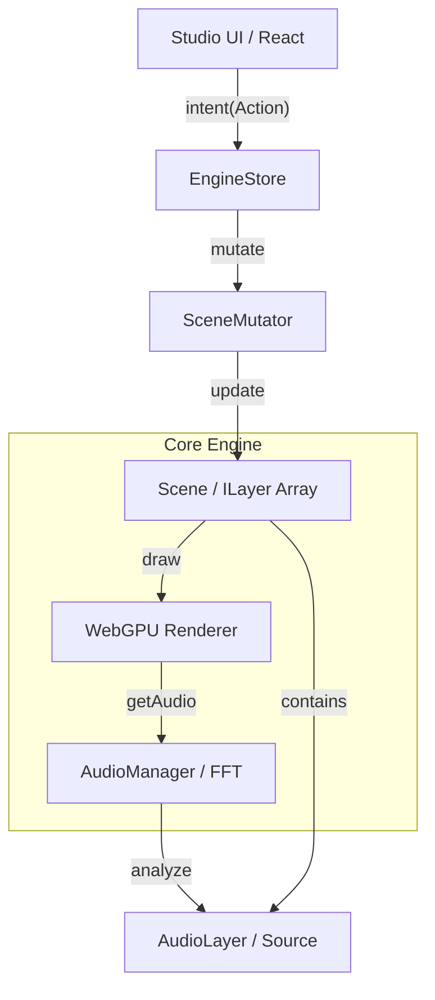

# ADR 003: Rendium Engine POC Evolution (CQRS and Audio Pipeline Integration)

[한국어](../ko/003-engine-poc-evolution.md)

## Context
As the initial Hybrid Flat structure (Unified Flat Architecture) stabilized, this optimization work was carried out to solve the state management complexity and audio visualization consistency issues that arose during integration with the actual application (Studio). Moving away from the previous direct class instance manipulation, a more robust and scalable communication interface was required.

## Decision

### 1. State Bridge: "Introduction of EngineStore (Update Pipeline)"
* **Decision:** Restrict all interactions between the UI (React) and the engine core to a single entry point, `EngineStore`.
* **Rationale:** While the engine internals operate with high-performance mutable state, the UI requires immutable snapshots. Separating these satisfies the requirements of both sides and prevents synchronization bugs.
* **Implementation:** Expose `getSnapshot` and `subscribe` APIs that can combine with React's `useSyncExternalStore`.

### 2. Audio Architecture: "Separation of AudioManager & AudioLayer"
* **Decision:** Reorganize the architecture by separating the roles of audio analysis (Global) and audio playback (Local).
* **AudioManager:** Exists as a singleton, providing frequency data shared by all visualization layers via the global `AudioContext` and an FFT analyzer.
* **AudioLayer:** Integrated as a formal member of the 1D layer stack. This means audio is also managed as an "entity" on the timeline with a `startTime` and `duration`.

### 3. System Stability: "Strengthening Project Anchor Protection"
* **Decision:** Apply engine-level modification limits to core layers (Project Anchor, Background) that all projects must have.
* **Mechanism:** Introduce the `isProjectAnchor: true` flag to prevent the deletion or reordering (move) commands for these layers in `SceneMutator` at the engine core level. This prevents destruction of the project structure due to user mistakes.

### 4. GPU Standardization Early Phase: "112-byte Uniform Alignment"
* **Decision:** Standardize the WebGPU layer uniform buffer layout to 112 bytes in the early phase. (Note: Later increased to 256 bytes for stability).
* **Rationale:** A minimum safety measure to comply with WebGPU's `minUniformBufferOffsetAlignment` constraint and prevent shader binding validation errors.

## Consequences and Benefits
1. **Improved Development Productivity:** UI developers can control all features through intent-based commands without knowing the engine's internal logic.
2. **Precision in Audio Sync:** By integrating audio into the layer system, time drift between video seeking/rendering and audio playback disappears.
3. **Runtime Stability:** Root protection and standardized GPU layouts reduce the chance of unexpected crashes or data corruption.

---

### Integrated Architecture (Conceptual Diagram)

