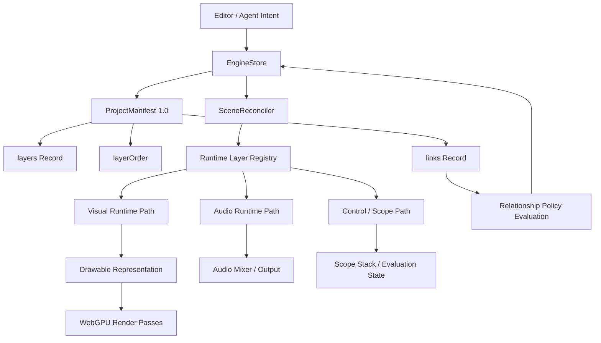
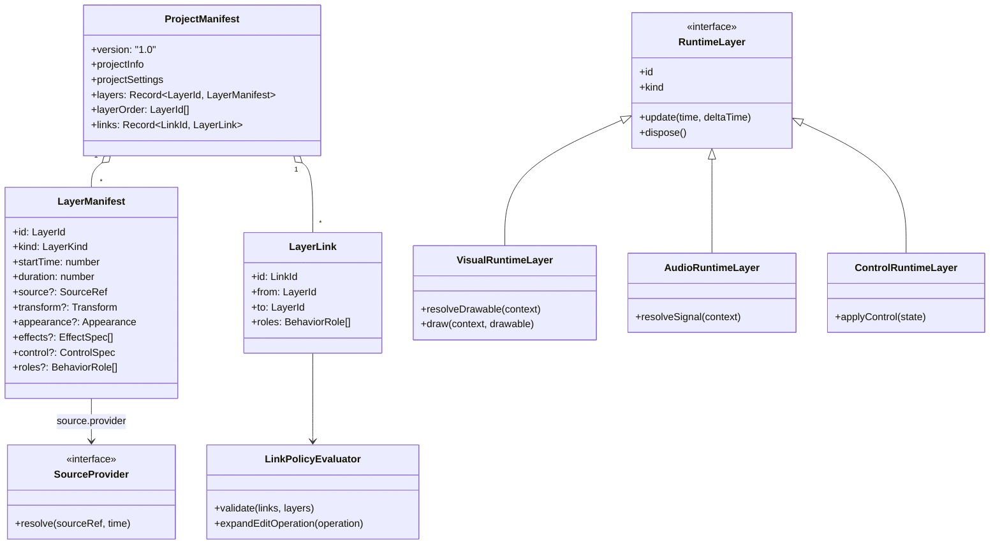
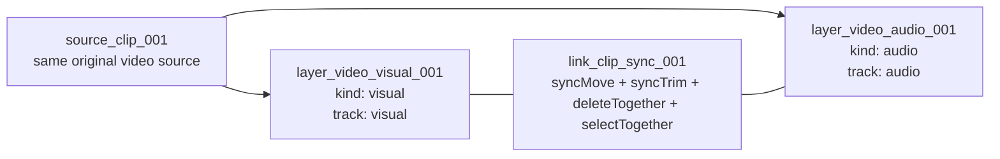
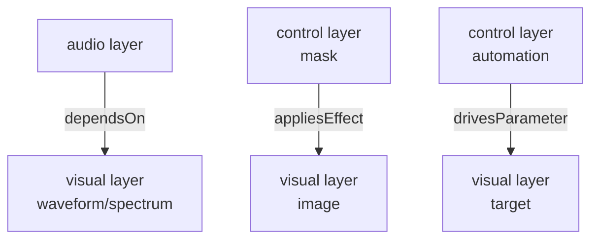
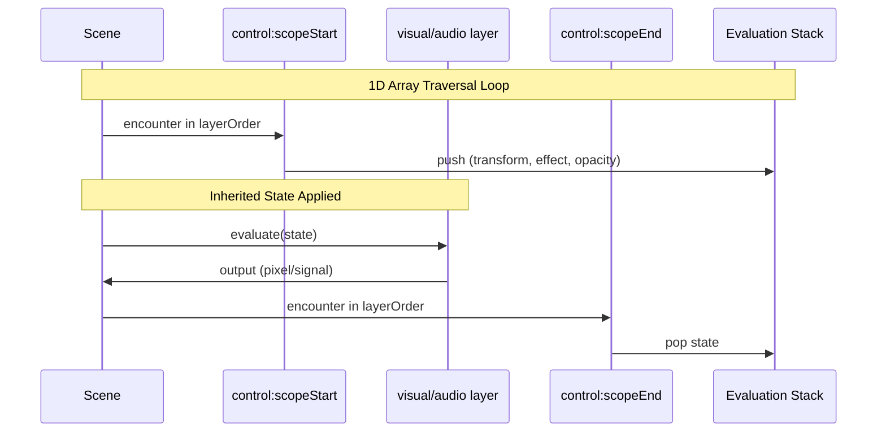

# ADR 009: Minimal Layer Model

[한국어](../ko/009-minimal-layer-model.md)

- **Status**: Accepted / Implemented
- **Audience**: Pre-release `1.0` Redesign
- **Manifest Version**: `1.0`
- **Scope**: `@rendium/engine` layer model, manifest structure, runtime abstraction, relationship model

## 1. Background

The Rendium Engine is a WebGPU-based non-linear editing engine. The initial prototype structure separates runtime layers based on media domains or feature names, such as `image`, `video`, `text`, `spectrum`, `audio`, `audio-visualizer`, `scope:start`, and `scope:end`.

This approach is easy to understand in the early implementation phases. However, as the number of elements the editor must handle increases, the maintenance cost grows rapidly. Future products must handle static images, animated images, SVGs, videos, text, shapes, stickers, generated visuals, audio, voice, generated audio, masks, adjustment scopes, automations, markers, transitions, procedural effects, etc. If each of these formats or product concepts becomes a top-level layer type, the engine complexity increases linearly with the number of features.

Especially in a solo developer environment, this cost is a key constraint. If every time a new element is added, factory branching, manifest types, inspector handling, reconciler paths, draw paths, validation branches, and migration logic all increase, both development speed and stability will deteriorate. Therefore, the engine should minimize the number of top-level layer types, and absorb detailed differences into source providers, drawable representations, behavior roles, and control specs.

This migration redefines layer types not by the media format name but by the **output responsibility performed by the engine**.

## 2. Key Decisions

The Rendium Engine models all timeline elements into three top-level layer types:

```ts
type LayerKind = 'visual' | 'audio' | 'control';
```

- `visual`: Produces a drawable representation that can be rendered visually.
- `audio`: Produces audio signals.
- `control`: Controls interpretation, groups, states, parameters, and sequence operations without directly producing pixels or sound.

Media formats and editor features are not top-level layer types. They are expressed through combinations of `source`, `track`, `provider`, `effects`, `control`, and `roles`.

The manifest continues to maintain a flat structure:

- `layers: Record<LayerId, LayerManifest>` is a stable, ID-based layer property store.
- `layerOrder: LayerId[]` is the sole standard for sequence and render order.
- `links: Record<LinkId, LayerLink>` stores relationships between layers, without introducing a layer tree or parent-child ownership.

Since the product is pre-release and the redesign will be conducted in a separate branch, the manifest version is maintained at `1.0`. Gradual compatibility migration is excluded from the goals if it introduces excessive overhead, as it does not align with the intentions of a solo developer environment.

## 3. Why

### 3.1 Layer types must describe output responsibilities

The question the engine layer must answer is:

```text
What responsibility does this timeline item have at runtime?
```

Conversely, the following question should not be the basis for layer types:

```text
Which file format or product feature created this item?
```

For example, PNG, JPEG, GIF, SVG, text, shapes, video frames, waveforms, and procedural graphics are all visual outputs. WAV, MP3, voiceovers, generated audio, and video audio tracks are all audio outputs. Scope, markers, masks, automation, adjustments, camera, and transition controllers control interpretation or behavior.

Therefore, layer types must be reduced to capability-centric runtime paths rather than a list of feature-specific classes.

### 3.2 The architectural dimensions must be reduced in a solo developer environment

Every time a top-level layer type is added, the following costs are incurred:

- Increase in manifest types
- Increase in runtime factories
- Increase in patch reconciliation branching
- Increase in serialization and validation complexity
- Increase in UI integration points
- Increase in the test matrix
- Increase in future migrations

The goal is not to avoid abstraction. The goal is to choose an abstraction that absorbs future features without increasing the number of decision points.

The minimal layer model reduces the engine's core questions to three:

1. Is this element drawn?
2. Does this element make sound?
3. Does this element control the state, relationship, or interpretation of other elements?

Most future features will be represented by adding source providers, drawable providers, effect specs, or behavior roles rather than new top-level layer types.

### 3.3 Flat order and relationship models must be separated

Rendium already benefits from a flat manifest and a marker-based sequence model. Recursive trees are intuitive at first but introduce complexity in reordering, subtree mutations, patch path stability, undo/redo, and ownership interpretation.

The target structure maintains the following properties:

- flat storage
- id-keyed records
- stable patch paths
- explicit render order
- stack-based interpretation of scope markers

Relationships such as `move together`, `delete together`, `control this parameter`, or `reference this audio data` are not render orders. These relationships should be handled in a separate link graph.

In other words, links must not become a channel for reintroducing trees.

### 3.4 Source identity and layer identity are different

The product level already has a source URL or asset management policy. The engine must not determine layer identity based solely on the source URL.

The same original source can produce multiple independent layers:

- A single video source creates a visual track layer and an audio track layer.
- The same image source appears multiple times with different transforms.
- The same video source is placed on the timeline with different clip ranges.
- The same audio source drives playback and a visualizer simultaneously.

Therefore, source reference and layer identity must be separated. A layer is an output unit on the timeline, a source is the input material, and a track defines which output channel of the source to use.

## 4. Proposed Manifest Draft

The code below is pseudocode for explaining the target architecture. It should be read as a design contract, not final implementation code.

```ts
type LayerId = string;
type LinkId = string;
type SourceId = string;

type LayerKind = 'visual' | 'audio' | 'control';

interface ProjectManifest {
  version: '1.0';
  projectInfo: ProjectInfo;
  projectSettings: ProjectSettings;
  layers: Record<LayerId, LayerManifest>;
  layerOrder: LayerId[];
  links: Record<LinkId, LayerLink>;
}

interface LayerManifest {
  id: LayerId;
  kind: LayerKind;
  name?: string;
  startTime: number;
  duration: number;
  source?: SourceRef;
  transform?: Transform;
  appearance?: Appearance;
  effects?: EffectSpec[];
  control?: ControlSpec;
  roles?: BehaviorRole[];
}

interface SourceRef {
  sourceId: SourceId;
  track?: 'visual' | 'audio' | 'metadata';
  clipOffset?: number;
  playbackRate?: number;
  provider?: SourceProviderKind;
}

type SourceProviderKind =
  | 'raster'
  | 'animated-raster'
  | 'svg'
  | 'video'
  | 'text'
  | 'shape'
  | 'generated-visual'
  | 'audio-file'
  | 'generated-audio'
  | 'stream';

interface LayerLink {
  id: LinkId;
  from: LayerId;
  to: LayerId;
  roles: BehaviorRole[];
}

type BehaviorRole =
  | 'syncMove'
  | 'syncTrim'
  | 'deleteTogether'
  | 'selectTogether'
  | 'dependsOn'
  | 'drivesParameter'
  | 'inheritsTransform'
  | 'appliesEffect'
  | 'allowsCycle'
  | 'requiresAcyclic';

interface ControlSpec {
  role:
    | 'scopeStart'
    | 'scopeEnd'
    | 'marker'
    | 'adjustment'
    | 'mask'
    | 'camera'
    | 'automation'
    | 'transition';
  targetScopeId?: LayerId;
  params?: Record<string, unknown>;
}

interface Transform {
  position: { x: number; y: number };
  scale: { x: number; y: number };
  rotation: number;
}

interface Appearance {
  visible: boolean;
  opacity: number;
}

interface EffectSpec {
  kind: string;
  params: Record<string, unknown>;
}
```

## 5. Layer Type Mapping Verification

The table below verifies that currently expected editing elements can be represented by the three layer types.

| Editing Element | Layer Type | Point of Variation |
| --- | --- | --- |
| PNG/JPEG/WebP image | `visual` | `source.provider = 'raster'` |
| GIF/APNG/animated WebP | `visual` | `source.provider = 'animated-raster'` |
| SVG | `visual` | `source.provider = 'svg'` |
| Video image track | `visual` | `source.provider = 'video'`, `track = 'visual'` |
| Text | `visual` | `source.provider = 'text'` |
| Shape/path/sticker/logo | `visual` | `source.provider = 'shape'` or `raster` |
| Spectrum/waveform | `visual` | generated drawable driven by audio link |
| AI/generated bitmap | `visual` | `source.provider = 'generated-visual'` |
| Audio file | `audio` | `source.provider = 'audio-file'` |
| Video audio track | `audio` | `source.provider = 'video'`, `track = 'audio'` |
| Voice/TTS/generated audio | `audio` | `source.provider = 'generated-audio'` |
| Audio stream | `audio` | `source.provider = 'stream'` |
| Scope start/end | `control` | `control.role = 'scopeStart' | 'scopeEnd'` |
| Marker | `control` | `control.role = 'marker'` |
| Mask | `control` or `visual` | relationship control and optional visual matte |
| Adjustment layer | `control` | `control.role = 'adjustment'` |
| Camera | `control` | `control.role = 'camera'` |
| Automation | `control` | `control.role = 'automation'` |
| Transition controller | `control` | `control.role = 'transition'` |

If a new editor feature can be expressed by adding a provider, effect, control role, or behavior role before adding a top-level layer type, this model is valid.

## 6. Expressing Video as Separated Output Layers

Video is a key validation case for this design. A single video source typically includes both a visual track and an audio track.

In the target model, the source is viewed as shared input material, and the layers are viewed as separate timeline output units.

```ts
const videoVisualLayer: LayerManifest = {
  id: 'layer_video_visual_001',
  kind: 'visual',
  startTime: 10,
  duration: 5,
  source: {
    sourceId: 'source_clip_001',
    provider: 'video',
    track: 'visual',
    clipOffset: 3,
    playbackRate: 1,
  },
  transform: {
    position: { x: 0, y: 0 },
    scale: { x: 1, y: 1 },
    rotation: 0,
  },
  appearance: {
    visible: true,
    opacity: 1,
  },
};

const videoAudioLayer: LayerManifest = {
  id: 'layer_video_audio_001',
  kind: 'audio',
  startTime: 10,
  duration: 5,
  source: {
    sourceId: 'source_clip_001',
    provider: 'video',
    track: 'audio',
    clipOffset: 3,
    playbackRate: 1,
  },
};

const syncLink: LayerLink = {
  id: 'link_clip_sync_001',
  from: 'layer_video_visual_001',
  to: 'layer_video_audio_001',
  roles: ['syncMove', 'syncTrim', 'deleteTogether', 'selectTogether', 'requiresAcyclic'],
};
```

This structure removes ambiguity such as:

- If `visible = false`, should the audio be turned off too?
- If `opacity = 0`, should the audio be muted too?
- If the visual crop changes, should the audio change too?
- If the audio is detached, does the visual layer still own the audio?

The engine's answer is clear: visual and audio are separate output layers. The editing relationship between the two is represented by links and roles.

## 7. Behavior Role

`scope role` and `link role` should not be a giant fixed enum. Instead, they are expressed as combinations of small behavior roles.

Example:

```ts
const clipSyncRoles: BehaviorRole[] = [
  'syncMove',
  'syncTrim',
  'deleteTogether',
  'selectTogether',
  'requiresAcyclic',
];

const visualizerTargetRoles: BehaviorRole[] = [
  'dependsOn',
  'requiresAcyclic',
];

const automationRoles: BehaviorRole[] = [
  'drivesParameter',
  'requiresAcyclic',
];

const scopeEffectRoles: BehaviorRole[] = [
  'inheritsTransform',
  'appliesEffect',
];
```

The advantages of this approach are:

- Product-level concepts can be named as presets.
- Engine-level behaviors are kept in small, composable units.
- Validation can be defined on a per-role basis.
- The AI agent can reason by combining behaviors without creating new layer types.

## 8. Link Graph Policy

A link is relationship metadata. It does not directly affect render order and does not create nested ownership.

Recommended validation rules:

- `from` and `to` must reference existing layer IDs.
- `requiresAcyclic` prohibits cycles in that link group.
- `allowsCycle` is allowed only when explicitly declared and is rarely used.
- `deleteTogether` extends the delete operation to the linked set.
- `syncMove` and `syncTrim` affect edit operations and do not affect render traversal.
- `dependsOn` can allow fallback behavior when the target is missing or muted.
- Dangling links must be removed, disabled, or surfaced as validation errors before rendering.

The link graph is a policy layer on top of the flat timeline; it does not replace `layerOrder`.

## 9. Scope Boundaries

Scope is maintained as a control layer existing inside `layerOrder`.

The reasons for this decision are:

- Maintains flat sequence interpretation.
- Enables stack-based transform and opacity inheritance.
- Allows applying scope-level effects in the future.
- Keeps grouping information explicitly in the engine timeline.

However, scope is not a typical parent-child ownership tree. Scope markers are interpreted during traversal. Links express relationships. The two systems must be separated.

```text
scope = structural/control marker inside layerOrder
link  = relationship policy between layer IDs
```

## 10. Runtime Abstraction

The engine must not assume that all visual layers are simple textures.

Many visual sources can be textures:

- raster image
- video frame
- rasterized SVG
- canvas/rasterized text
- generated bitmap

However, some visual outputs may be better represented as:

- geometry
- storage-buffer-driven procedural rendering
- shader-only output
- offscreen render target
- cached texture atlas entry

Therefore, the runtime abstraction must target a broader drawable representation.

```ts
interface VisualRuntimeLayer extends RuntimeLayer {
  kind: 'visual';
  resolveDrawable(context: RenderContext): DrawableRepresentation | null;
  draw(context: RenderContext, drawable: DrawableRepresentation): void;
}

type DrawableRepresentation =
  | TextureDrawable
  | GeometryDrawable
  | StorageBufferDrawable
  | ProceduralDrawable
  | OffscreenDrawable;

interface AudioRuntimeLayer extends RuntimeLayer {
  kind: 'audio';
  resolveSignal(context: AudioContextLike): AudioSignal | null;
}

interface ControlRuntimeLayer extends RuntimeLayer {
  kind: 'control';
  applyControl(state: EvaluationState): void;
}
```

This structure keeps the public layer model small while leaving room for internal optimizations in the renderer.

## 11. Overall Architecture Flow



## 12. Class / Interface Diagram



## 13. Visual/Audio Separation of the Same Video Source



The same source can be referenced by more than one layer. Layer identity is determined by a combination of layer ID, timeline timing, source ref, track selection, and role, rather than the source URL alone.

## 14. Link Graph Example



These links are evaluated separately from the render order. Links can affect edit operations, parameter evaluations, and dependency validation but do not imply tree ownership.

## 15. Scope Stack Evaluation Structure



The mathematical model is maintained on a stack basis:

```text
M_final = M_scope_0 * M_scope_1 * ... * M_scope_n * M_local
```

In the future, scope state can include not only transform and opacity but also scope-level effects, offscreen target configurations, and masking states.

## 16. GPU Direction

This migration does not claim that the current manifest can be directly uploaded to a single GPU buffer immediately. The immediate benefit is architectural simplification. The number of layer types is reduced, traversal is flattened, and source resolution and reconciliation branching become clearer.

The long-term GPU-oriented direction we expect is:

- Linear traversal based on `layerOrder`
- Compact render item generation in runtime layers
- Source cache reuse among layers sharing the same source ID
- Batching of compatible drawable representations
- Incremental updates and invalidation based on stable IDs
- Offscreen pass planning for scope and adjustment layers
- Future GPU buffer packing of transforms, appearances, draw parameters, and effect uniforms

The flat model is a prerequisite for these optimizations because it avoids recursive tree traversal and maintains render order explicitly.

## 17. Migration Path

Since this is a pre-release `1.0` redesign, the target migration is based on direct transition.

1. Replace the domain layer type vocabulary with `LayerKind`.
2. Introduce `SourceRef` as the engine-facing source reference contract.
3. Introduce `links` for relationship policy.
4. Convert existing visual concepts into a combination of `kind: 'visual'` and provider.
5. Convert existing audio concepts into `kind: 'audio'`.
6. Convert scopes and non-output controllers into `kind: 'control'`.
7. Replace type-specific factories with capability-based runtime construction.
8. Replace role-specific hardcoding with behavior role bundles.
9. Route reconciliation based on manifest sections and layer kinds.
10. Add validation for links, source refs, scope marker balance, and behavior role constraints.
11. Throw errors without exception for all unimplemented cases.

Do not add compatibility shims. The target is a direct transition pre-release, and legacy `type`/`props`/`2.0` manifests are surfaced as validation errors rather than converted.

## 18. Acceptance Criteria

This design is valid when the following conditions are met:

- All known editor elements are represented as either `visual`, `audio`, or `control`.
- The same video source can produce separate visual and audio layers.
- The source URL is not treated as layer identity.
- Video sync behavior is represented by track refs and behavior links.
- Scopes are maintained as flat marker-based compositions.
- Links are maintained as relationship metadata outside the render order.
- Visual rendering is modeled as drawable representations rather than textures alone.
- Adding future features basically does not require increasing top-level layer kinds.
- Opens a path for future GPU optimization through linear traversal and compact render item generation.

## 19. Non-Goals

- This document does not define product-level asset URL policies.
- This document does not require legacy compatibility shims.
- This document does not target a backward-compatible migration from the current prototype model.
- This document does not assume that all visual outputs must use the same shader or texture path.
- This document does not replace the flat scope model with a recursive tree.
