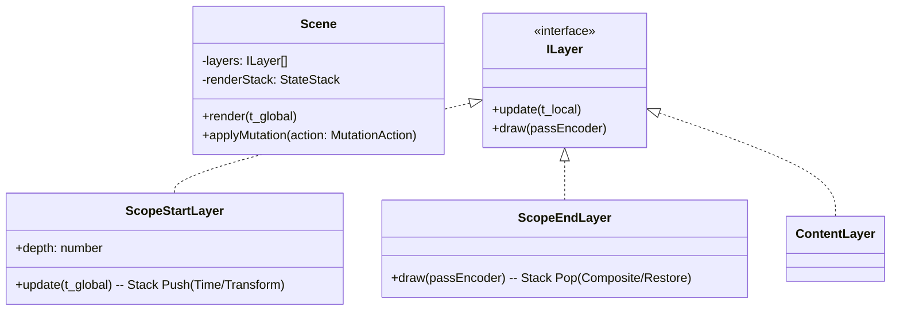

# ADR 002: Unified Flat Architecture (단일 플랫 아키텍처) 결정 고지

[English](../en/002-unified-flat-architecture.md)

## 대상 (Context)
초기 렌더링 엔진(Rendium) 구축 과정에서 특히 **'스코프(Scope, 구 Group)' 단위의 레이어 상태 관리 병목**을 해결하기 위해 도출된 최적화 구조인 **'하이브리드 플랫 구조(1차원 배열 + 마커)'**의 구체화 과정입니다. 엔진(Core)과 스튜디오(UI) 간의 상태 동기화 방식, 레이어 조작 안정성 확보, 멀티패스 이펙트 및 시킹(Seeking) 최적화에 대한 명확한 설계 기준이 필요했습니다.

## 결정 사항 (Decision)
기존의 제안된 4가지 주요 쟁점에 대해 검토한 결과, 데이터(Data)-UI(Studio)-엔진(Core) 모두가 **단일 1차원 배열(1D Array)을 공유하는 '단일 플랫(Unified Flat)' 구조**를 최종 채택하기로 명문화합니다.

### 1. 상태 모델: "트리 분리 없음 (Single Source of Truth)"
* **결정:** UI용 트리 구조를 별도로 관리하지 않습니다. 괄호(`ScopeStart`/`ScopeEnd`) 마커가 포함된 1차원 배열 자체가 앱 전체의 유일한 원본 상태(Source of Truth)입니다.
* **사유:** 트리 모델과 플랫 배열 간의 설계적 이중화 및 동기화 오버헤드, 무결성 이슈를 원천 차단하기 위함입니다. UI는 플랫 배열 요소의 `depth` 정보를 바탕으로 **'Bracket UI(들여쓰기 가이드)'**를 렌더링하여 사용자에게 직관적인 계층 인터페이스를 제공합니다.

### 2. 레이어 뮤테이션: "원자적 트랜잭션 (Atomic Mutation)"
* **결정:** `SceneMutator` (또는 이와 유사한 전담 클래스/리듀서)를 도입하여 배열 조작을 프레임워크 레벨에서 캡슐화합니다.
* **방식:** 레이어/스코프의 삽입 크기 변경, 이동 시 `[ScopeStart, ...children, ScopeEnd]` 덩어리 전체를 하나의 **원자적 단위(Atomic Unit)**로 취급하여 `splice` 연산을 수행합니다. 이는 괄호 짝이 어긋나 렌더링 파이프라인이 붕괴되는 것을 막는 강력한 가드레일 역할을 합니다.

### 3. 멀티패스 렌더링: "스택 기반 상태 전이 (Stack-based State Transition)"
* **결정:** `ScopeStart`와 `ScopeEnd`가 WebGPU의 Render Pass 생명주기를 직접 관리하도록 구현합니다.
* **방식:** 스코프 단위의 속성(Opacity, Blur 등 포스트 프로세싱 효과) 적용 시, `ScopeStart`에서 임시 오프스크린 텍스처(프레임버퍼)로 렌더 패스를 전환하고, 렌더링 스택(StateStack)이 반환되는 `ScopeEnd` 단계에서 부모 패스에 다시 합성(Composite)하는 구조를 엔진에 내장합니다.

### 4. 성능 최적화: "지연된 최적화 (Deferred Optimization)"
* **결정:** 초기 단계에서는 별도의 시공간 분할(Interval Tree 등) 없이 전체 배열을 순차 탐색하는 $O(n)$ 루프를 유지합니다.
* **사유:** 성급한 최적화를 지양하며, WebGPU 환경에서 V8 엔진의 1차원 배열 루프 오버헤드보다 데이터 일관성과 설계의 단순성을 확보하는 것이 훨씬 더 중요하기 때문입니다. 향후 레이어 수가 수천 개를 초과해 병목이 발생할 경우에만 구간 인덱싱을 도입할 수 있도록 엔진 내부 인터페이스만 확장 가능하게 열어둡니다.

## 결과 및 기대 효과 (Consequences)
1. **단일 진실 공급원 확보:** 상태 동기화 누락으로 인해 렌더러와 UI의 모습이 달라지는 근본적인 버그 발생 요인이 제거됩니다.
2. **무결성 렌더링 파이프라인:** 괄호 구조의 무결성이 `SceneMutator`에 의해 철저하게 보장되므로, 강력하고 안정적인 Undo/Redo 기능 구현의 발판이 됩니다.
3. **가독성 및 유지보수성 향상:** 엔진 코어가 과도한 최적화 로직 없이 직관적인 스택(Stack) 루프로 구성되어 시스템 확장(새로운 레이어나 효과 추가) 시 구조 파악이 용이해집니다.

---

### 최종 확정 클래스 구조 (Mermaid)

