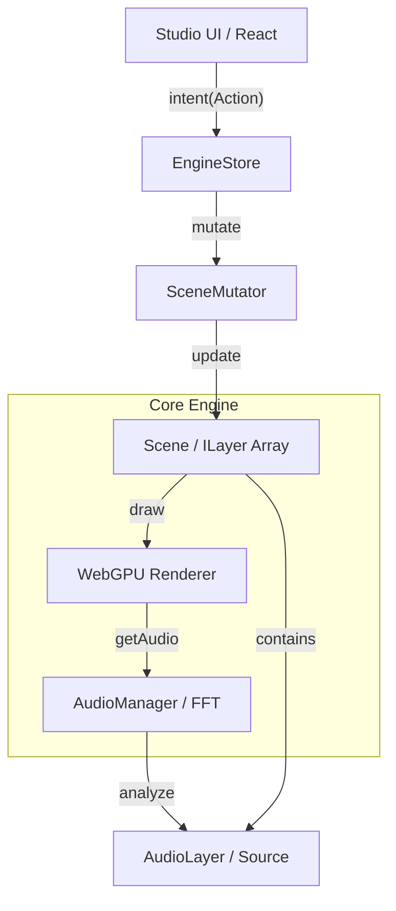

# ADR 003: Rendium Engine POC 진화 (CQRS 및 오디오 파이프라인 통합)

[English](../en/003-engine-poc-evolution.md)

## 대상 (Context)
초기 하이브리드 플랫 구조(Unified Flat Architecture)가 안정화됨에 따라, 이를 실제 애플리케이션(Studio)에 통합하는 과정에서 발생하는 상태 관리 복잡성과 오디오 시각화의 일관성 문제를 해결하기 위한 고도화 작업입니다. 이전의 직접적인 클래스 인스턴스 조작 방식에서 벗어나, 더욱 견고하고 확장 가능한 통신 인터페이스가 필요했습니다.

## 결정 사항 (Decision)

### 1. 상태 브릿지: "EngineStore (Update Pipeline) 도입"
*   **결정:** UI(React)와 엔진 코어 사이의 모든 상호작용을 `EngineStore` 단일 진입점으로 제한합니다.
*   **사유:** 엔진 내부는 고성능 가변(Mutable) 상태로 동작하는 반면, UI는 불변(Immutable) 스냅샷을 필요로 합니다. 이를 분리함으로써 양측의 요구사항을 충족하고 동기화 버그를 차단합니다.
*   **구현:** `useSyncExternalStore`와 결합 가능한 `getSnapshot`, `subscribe` API를 제공합니다.

### 2. 오디오 아키텍처: "AudioManager & AudioLayer 분리"
*   **결정:** 오디오 분석(Global)과 오디오 재생(Local)의 역할을 분리하여 아키텍처를 재구성합니다.
*   **AudioManager:** 싱글톤으로 존재하며, 전역 `AudioContext`와 FFT 분석기를 통해 모든 시각화 레이어가 공유하는 주파수 데이터를 제공합니다.
*   **AudioLayer:** 1차원 레이어 스택의 정식 구성원으로 편입됩니다. 이는 오디오 역시 타임라인 상의 하나의 '개체'로서 `startTime`과 `duration`을 가지고 관리되어야 함을 의미합니다.

### 3. 시스템 안정성: "프로젝트 앵커 보호(Project Anchor Protection) 강화"
*   **결정:** 모든 프로젝트가 반드시 가져야 하는 핵심 레이어(Project Anchor, Background)에 대해 엔진 레벨의 수정 제한을 적용합니다.
*   **방식:** `isProjectAnchor: true` 플래그를 도입하여 `SceneMutator`에서 해당 레이어의 삭제(Delete) 및 순서 변경(Move) 명령을 원천적으로 차단합니다. 이를 통해 사용자 실수로 인한 프로젝트 구조 파괴를 방지합니다.

### 4. GPU 표준화 초기 단계: "112-byte Uniform 정렬"
*   **결정:** 초기 WebGPU 레이어의 유니폼 버퍼 레이아웃을 112바이트로 표준화합니다. (참고: 이후 안정성 확보를 위해 256바이트로 상향 조정됨)
*   **사유:** WebGPU의 `minUniformBufferOffsetAlignment` 제약을 준수하고, 셰이더 바인딩 검증 오류를 방지하기 위한 최소 안전장치입니다.

## 결과 및 기대 효과 (Consequences)
1.  **개발 생산성 향상:** UI 개발자는 엔진의 내부 로직을 몰라도 intent 기반 명령만으로 모든 기능을 제어할 수 있습니다.
2.  **오디오 동기화 정밀도 확보:** 오디오가 레이어 시스템에 통합됨에 따라 영상과 소리의 시킹(Seeking) 및 프리뷰 동영상 추출 간의 시간적 오차가 사라집니다.
3.  **런타임 안정성:** 루트 보호와 표준화된 GPU 레이아웃을 통해 예기치 못한 크래시나 데이터 손상 가능성이 낮아졌습니다.

---

### 통합 아키텍처 (Conceptual Diagram)

