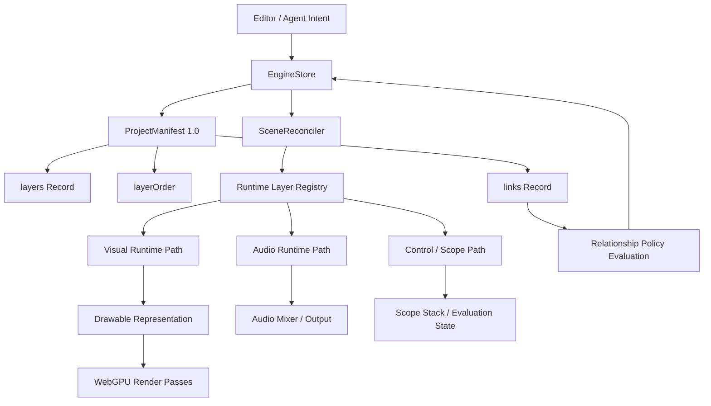
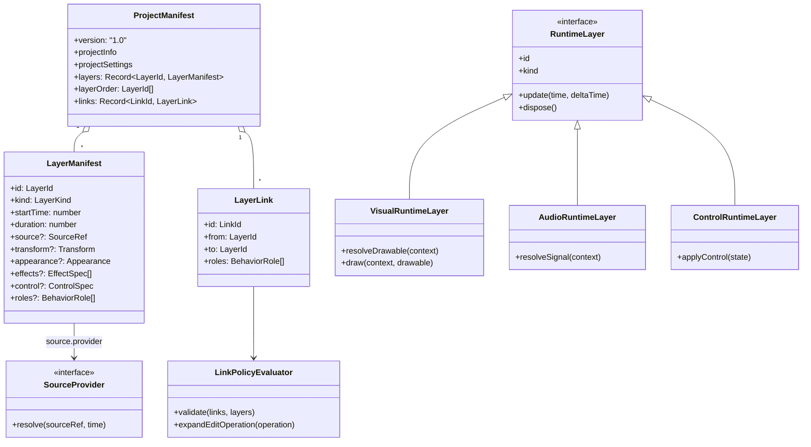
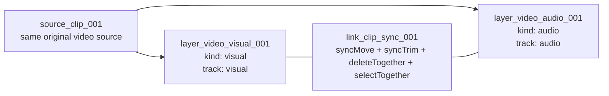
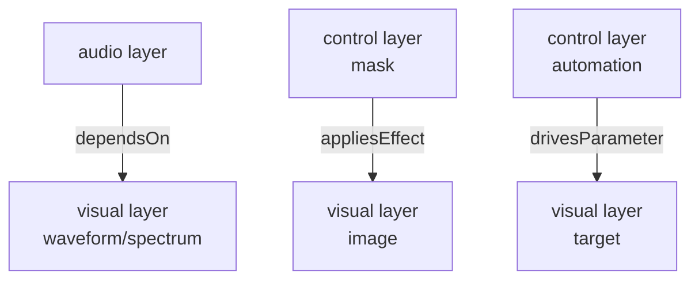
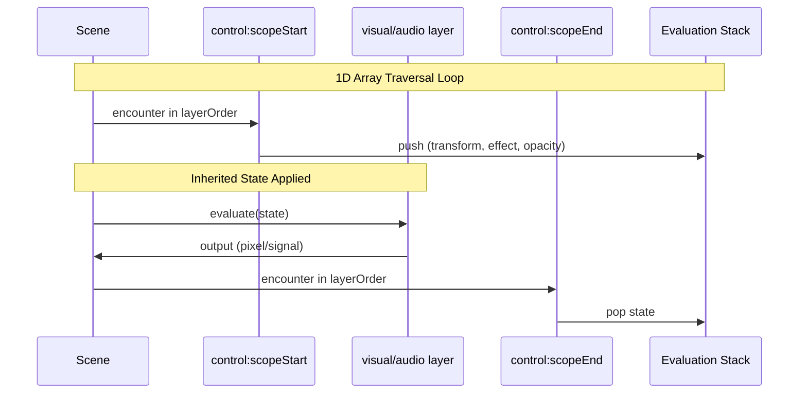

# ADR 009: 최소 레이어 모델

[English](../en/009-minimal-layer-model.md)

- **상태**: Accepted / Implemented
- **대상**: 출시 전 `1.0` 재설계
- **Manifest Version**: `1.0`
- **범위**: `@rendium/engine` 레이어 모델, manifest 구조, 런타임 추상화, 관계 모델

## 1. 배경

Rendium Engine은 WebGPU 기반의 비선형 편집 엔진이다. 현재 프로토타입 구조는 `image`, `video`, `text`, `spectrum`, `audio`, `audio-visualizer`, `scope:start`, `scope:end`처럼 미디어 도메인 또는 기능 이름을 기준으로 런타임 레이어를 분리한다.

이 방식은 초기 구현 단계에서는 이해하기 쉽다. 그러나 편집기가 다루어야 할 요소가 늘어나면 빠르게 유지보수 비용이 커진다. 향후 제품은 정적 이미지, animated image, SVG, video, text, shape, sticker, generated visual, audio, voice, generated audio, mask, adjustment scope, automation, marker, transition, procedural effect 등을 다루어야 한다. 이때 각각의 포맷이나 제품 개념이 최상위 레이어 타입이 되면 엔진 복잡도는 기능 수에 비례해 선형 증가한다.

특히 1인 개발 환경에서는 이 비용이 핵심 제약이다. 새 요소를 추가할 때마다 factory 분기, manifest 타입, inspector 처리, reconciler 경로, draw path, validation branch, migration logic이 함께 늘어난다면 개발 속도와 안정성이 모두 악화된다. 따라서 엔진은 최상위 레이어 종류를 최소화하고, 세부 차이는 source provider, drawable representation, behavior role, control spec으로 흡수해야 한다.

이 마이그레이션은 레이어 종류를 미디어 포맷 이름이 아니라 **엔진이 수행하는 출력 책임**으로 정의한다.

## 2. 핵심 결정

Rendium Engine은 모든 timeline element를 세 가지 최상위 레이어 종류로 모델링한다.

```ts
type LayerKind = 'visual' | 'audio' | 'control';
```

- `visual`: 시각적으로 그려질 수 있는 drawable representation을 만든다.
- `audio`: 오디오 신호를 만든다.
- `control`: 직접 픽셀이나 소리를 만들지 않더라도 해석, 그룹, 상태, 파라미터, sequence 동작을 제어한다.

미디어 포맷과 editor feature는 최상위 레이어 종류가 아니다. 이들은 `source`, `track`, `provider`, `effects`, `control`, `roles`의 조합으로 표현한다.

Manifest는 계속 flat 구조를 유지한다.

- `layers: Record<LayerId, LayerManifest>`는 안정적인 id 기반 레이어 속성 저장소다.
- `layerOrder: LayerId[]`는 sequence와 render order의 유일한 기준이다.
- `links: Record<LinkId, LayerLink>`는 레이어 사이의 관계를 저장하되, layer tree나 부모-자식 소유권을 만들지 않는다.

프로덕트가 아직 출시 전이고 별도 브랜치에서 재설계를 진행할 예정이므로 manifest version은 `1.0`으로 유지한다. 점진적 호환 마이그레이션이 과도한 리소스를 만들 경우, 이는 1인 개발 환경에서의 의도와 맞지 않으므로 목표에서 제외한다.

## 3. 왜 이 결정을 내렸는가 (Why)

### 3.1 레이어 종류는 출력 책임을 설명해야 한다

엔진 레이어가 답해야 하는 질문은 다음과 같다.

```text
이 timeline item은 런타임에서 어떤 책임을 가지는가?
```

반대로 다음 질문이 레이어 종류의 기준이 되어서는 안 된다.

```text
이 item은 어떤 파일 포맷 또는 제품 기능에서 만들어졌는가?
```

예를 들어 PNG, JPEG, GIF, SVG, text, shape, video frame, waveform, procedural graphic은 모두 시각 출력이다. WAV, MP3, voiceover, generated audio, video audio track은 모두 오디오 출력이다. Scope, marker, mask, automation, adjustment, camera, transition controller는 해석이나 동작을 제어한다.

따라서 레이어 종류는 기능별 클래스 목록이 아니라 capability 중심의 런타임 경로로 축소되어야 한다.

### 3.2 1인 개발 환경에서는 아키텍처 축을 줄여야 한다

최상위 레이어 타입이 늘어날 때마다 다음 비용이 발생한다.

- manifest 타입 증가
- runtime factory 증가
- patch reconciliation 분기 증가
- serialization과 validation 증가
- UI 연동 증가
- 테스트 matrix 증가
- 미래 migration 증가

목표는 추상화를 피하는 것이 아니다. 목표는 미래 기능을 흡수하면서도 의사결정 지점을 늘리지 않는 추상화를 선택하는 것이다.

최소 레이어 모델은 엔진의 핵심 질문을 세 가지로 줄인다.

1. 이 요소는 그려지는가?
2. 이 요소는 소리를 내는가?
3. 이 요소는 다른 요소의 상태, 관계, 해석을 제어하는가?

대부분의 미래 기능은 새 최상위 레이어 종류가 아니라 source provider, drawable provider, effect spec, behavior role 추가로 표현된다.

### 3.3 Flat order와 관계 모델은 분리되어야 한다

Rendium은 이미 flat manifest와 marker-based sequence 모델의 이점을 가진다. Recursive tree는 처음에는 직관적이지만, reorder, subtree mutation, patch path 안정성, undo/redo, ownership 해석에서 복잡도를 만든다.

목표 구조는 다음 성질을 유지한다.

- 평면형 저장소 (flat storage)
- ID 키 기반 레코드 (id-keyed record)
- 안정적인 패치 경로 (stable patch path)
- 명시적인 렌더링 순서 (explicit render order)
- scope marker의 stack-based interpretation

`같이 이동한다`, `같이 삭제한다`, `이 파라미터를 제어한다`, `이 오디오 데이터를 참조한다` 같은 관계는 render order가 아니다. 이러한 관계는 별도의 link graph에서 다루어야 한다.

즉 link는 tree를 다시 도입하는 통로가 되어서는 안 된다.

### 3.4 Source identity와 layer identity는 다르다

Product 단에는 이미 source URL 또는 asset 관리 정책이 존재한다. 엔진은 source URL만으로 layer identity를 판단해서는 안 된다.

동일한 원본 source는 여러 독립 레이어를 만들 수 있다.

- 하나의 video source가 visual track layer와 audio track layer를 만든다.
- 같은 image source가 서로 다른 transform으로 여러 번 등장한다.
- 같은 video source가 서로 다른 clip range로 timeline에 배치된다.
- 같은 audio source가 playback과 visualizer를 동시에 구동한다.

따라서 source reference와 layer identity는 분리되어야 한다. 레이어는 timeline 위의 출력 단위이고, source는 입력 재료이며, track은 source의 어떤 출력 채널을 사용할지 정의한다.

## 4. 제안 Manifest 초안

아래 코드는 목표 아키텍처를 설명하기 위한 의사코드다. 최종 구현 코드가 아니라 설계 계약으로 읽어야 한다.

```ts
type LayerId = string;
type LinkId = string;
type SourceId = string;

type LayerKind = 'visual' | 'audio' | 'control';

interface ProjectManifest {
  version: '1.0';
  projectInfo: ProjectInfo;
  projectSettings: ProjectSettings;
  layers: Record<LayerId, LayerManifest>;
  layerOrder: LayerId[];
  links: Record<LinkId, LayerLink>;
}

interface LayerManifest {
  id: LayerId;
  kind: LayerKind;
  name?: string;
  startTime: number;
  duration: number;
  source?: SourceRef;
  transform?: Transform;
  appearance?: Appearance;
  effects?: EffectSpec[];
  control?: ControlSpec;
  roles?: BehaviorRole[];
}

interface SourceRef {
  sourceId: SourceId;
  track?: 'visual' | 'audio' | 'metadata';
  clipOffset?: number;
  playbackRate?: number;
  provider?: SourceProviderKind;
}

type SourceProviderKind =
  | 'raster'
  | 'animated-raster'
  | 'svg'
  | 'video'
  | 'text'
  | 'shape'
  | 'generated-visual'
  | 'audio-file'
  | 'generated-audio'
  | 'stream';

interface LayerLink {
  id: LinkId;
  from: LayerId;
  to: LayerId;
  roles: BehaviorRole[];
}

type BehaviorRole =
  | 'syncMove'
  | 'syncTrim'
  | 'deleteTogether'
  | 'selectTogether'
  | 'dependsOn'
  | 'drivesParameter'
  | 'inheritsTransform'
  | 'appliesEffect'
  | 'allowsCycle'
  | 'requiresAcyclic';

interface ControlSpec {
  role:
    | 'scopeStart'
    | 'scopeEnd'
    | 'marker'
    | 'adjustment'
    | 'mask'
    | 'camera'
    | 'automation'
    | 'transition';
  targetScopeId?: LayerId;
  params?: Record<string, unknown>;
}

interface Transform {
  position: { x: number; y: number };
  scale: { x: number; y: number };
  rotation: number;
}

interface Appearance {
  visible: boolean;
  opacity: number;
}

interface EffectSpec {
  kind: string;
  params: Record<string, unknown>;
}
```

## 5. 레이어 종류 매핑 검증

아래 표는 현재 예상 가능한 편집 요소가 세 가지 레이어 종류로 표현 가능함을 검증한다.

| 편집 요소 | 레이어 종류 | 변형 지점 |
| --- | --- | --- |
| PNG/JPEG/WebP image | `visual` | `source.provider = 'raster'` |
| GIF/APNG/animated WebP | `visual` | `source.provider = 'animated-raster'` |
| SVG | `visual` | `source.provider = 'svg'` |
| Video image track | `visual` | `source.provider = 'video'`, `track = 'visual'` |
| Text | `visual` | `source.provider = 'text'` |
| Shape/path/sticker/logo | `visual` | `source.provider = 'shape'` 또는 `raster` |
| Spectrum/waveform | `visual` | audio link가 구동하는 generated drawable |
| AI/generated bitmap | `visual` | `source.provider = 'generated-visual'` |
| Audio file | `audio` | `source.provider = 'audio-file'` |
| Video audio track | `audio` | `source.provider = 'video'`, `track = 'audio'` |
| Voice/TTS/generated audio | `audio` | `source.provider = 'generated-audio'` |
| Audio stream | `audio` | `source.provider = 'stream'` |
| Scope start/end | `control` | `control.role = 'scopeStart' | 'scopeEnd'` |
| Marker | `control` | `control.role = 'marker'` |
| Mask | `control` 또는 `visual` | 관계 제어와 optional visual matte |
| Adjustment layer | `control` | `control.role = 'adjustment'` |
| Camera | `control` | `control.role = 'camera'` |
| Automation | `control` | `control.role = 'automation'` |
| Transition controller | `control` | `control.role = 'transition'` |

새로운 editor feature가 등장했을 때 최상위 레이어 종류를 추가하기 전에 provider, effect, control role, behavior role 추가로 표현 가능하다면 이 모델은 유효하다.

## 6. 비디오를 분리된 출력 레이어로 표현하기

비디오는 이 설계의 핵심 검증 사례다. 하나의 video source는 일반적으로 visual track과 audio track을 동시에 포함한다.

목표 모델에서는 source를 공유 입력 재료로 보고, layer를 별도의 timeline 출력 단위로 본다.

```ts
const videoVisualLayer: LayerManifest = {
  id: 'layer_video_visual_001',
  kind: 'visual',
  startTime: 10,
  duration: 5,
  source: {
    sourceId: 'source_clip_001',
    provider: 'video',
    track: 'visual',
    clipOffset: 3,
    playbackRate: 1,
  },
  transform: {
    position: { x: 0, y: 0 },
    scale: { x: 1, y: 1 },
    rotation: 0,
  },
  appearance: {
    visible: true,
    opacity: 1,
  },
};

const videoAudioLayer: LayerManifest = {
  id: 'layer_video_audio_001',
  kind: 'audio',
  startTime: 10,
  duration: 5,
  source: {
    sourceId: 'source_clip_001',
    provider: 'video',
    track: 'audio',
    clipOffset: 3,
    playbackRate: 1,
  },
};

const syncLink: LayerLink = {
  id: 'link_clip_sync_001',
  from: 'layer_video_visual_001',
  to: 'layer_video_audio_001',
  roles: ['syncMove', 'syncTrim', 'deleteTogether', 'selectTogether', 'requiresAcyclic'],
};
```

이 구조는 다음과 같은 모호함을 제거한다.

- `visible = false`이면 audio도 꺼져야 하는가?
- `opacity = 0`이면 audio도 mute되어야 하는가?
- visual crop이 바뀌면 audio도 바뀌어야 하는가?
- audio를 detach하면 visual layer가 여전히 audio를 소유하는가?

엔진의 답은 명확하다. Visual과 audio는 별도 출력 레이어다. 둘 사이의 편집 관계는 link와 role로 표현한다.

## 7. 동작 역할 (Behavior Role)

`scope role`과 `link role`은 거대한 고정 enum이 되어서는 안 된다. 대신 작은 behavior role의 조합으로 표현한다.

예시:

```ts
const clipSyncRoles: BehaviorRole[] = [
  'syncMove',
  'syncTrim',
  'deleteTogether',
  'selectTogether',
  'requiresAcyclic',
];

const visualizerTargetRoles: BehaviorRole[] = [
  'dependsOn',
  'requiresAcyclic',
];

const automationRoles: BehaviorRole[] = [
  'drivesParameter',
  'requiresAcyclic',
];

const scopeEffectRoles: BehaviorRole[] = [
  'inheritsTransform',
  'appliesEffect',
];
```

이 방식의 장점은 다음과 같다.

- product-level 개념은 preset으로 이름 붙일 수 있다.
- engine-level 동작은 작고 조합 가능한 단위로 유지된다.
- validation을 role 단위로 정의할 수 있다.
- AI agent가 새로운 layer type을 만들지 않고도 동작을 조합해 추론할 수 있다.

## 8. Link Graph 정책

Link는 관계 metadata다. Link는 render order에 직접 영향을 주지 않으며 nested ownership을 만들지 않는다.

권장 validation 규칙:

- `from`과 `to`는 존재하는 layer id를 참조해야 한다.
- `requiresAcyclic`은 해당 link group의 cycle을 금지한다.
- `allowsCycle`은 명시적으로 선언된 경우에만 허용하며 드물게 사용한다.
- `deleteTogether`는 삭제 작업을 linked set으로 확장한다.
- `syncMove`와 `syncTrim`은 edit operation에 영향을 주며 render traversal에는 영향을 주지 않는다.
- `dependsOn`은 target이 없거나 muted 상태일 때 fallback 동작을 허용할 수 있다.
- dangling link는 render 전에 제거, 비활성화, 또는 validation error로 표면화되어야 한다.

Link graph는 flat timeline 위의 policy layer이지 `layerOrder`를 대체하지 않는다.

## 9. Scope 경계

Scope는 `layerOrder` 안에 존재하는 control layer로 유지한다.

이 결정의 이유는 다음과 같다.

- flat sequence interpretation을 유지한다.
- stack-based transform과 opacity inheritance를 가능하게 한다.
- 향후 scope-level effect를 적용할 수 있다.
- grouping 정보를 engine timeline에 명시적으로 남긴다.

그러나 scope는 일반적인 parent-child ownership tree가 아니다. Scope marker는 traversal 중에 해석된다. Link는 관계를 표현한다. 두 시스템은 분리되어야 한다.

```text
scope = layerOrder 안의 구조적/control marker
link  = layer id 사이의 관계 policy
```

## 10. Runtime 추상화

엔진은 모든 visual layer가 단순 texture라고 가정해서는 안 된다.

많은 visual source는 texture가 될 수 있다.

- 래스터 이미지 (raster image)
- 비디오 프레임 (video frame)
- 래스터화된 SVG (rasterized SVG)
- 캔버스/래스터화된 텍스트 (canvas/rasterized text)
- 생성된 비트맵 (generated bitmap)

하지만 일부 visual output은 다음 표현이 더 적합할 수 있다.

- 기하학 정보 (geometry)
- 스토리지 버퍼 구동 절차적 렌더링 (storage-buffer-driven procedural rendering)
- 셰이더 전용 출력 (shader-only output)
- 오프스크린 렌더 타겟 (offscreen render target)
- 캐시된 텍스처 아틀라스 엔트리 (cached texture atlas entry)

따라서 runtime 추상화는 더 넓은 drawable representation을 대상으로 해야 한다.

```ts
interface VisualRuntimeLayer extends RuntimeLayer {
  kind: 'visual';
  resolveDrawable(context: RenderContext): DrawableRepresentation | null;
  draw(context: RenderContext, drawable: DrawableRepresentation): void;
}

type DrawableRepresentation =
  | TextureDrawable
  | GeometryDrawable
  | StorageBufferDrawable
  | ProceduralDrawable
  | OffscreenDrawable;

interface AudioRuntimeLayer extends RuntimeLayer {
  kind: 'audio';
  resolveSignal(context: AudioContextLike): AudioSignal | null;
}

interface ControlRuntimeLayer extends RuntimeLayer {
  kind: 'control';
  applyControl(state: EvaluationState): void;
}
```

이 구조는 public layer model을 작게 유지하면서 renderer 내부 최적화 여지를 남긴다.

## 11. 전체 아키텍처 흐름



## 12. Class / Interface 다이어그램



## 13. 동일 비디오 source의 visual/audio 분리



동일 source는 둘 이상의 layer에서 참조될 수 있다. Layer identity는 source URL만으로 결정되지 않고, layer id, timeline timing, source ref, track selection, role 조합에 의해 결정된다.

## 14. Link Graph 예시



이 link들은 render order와 별개로 평가된다. Link는 edit operation, parameter evaluation, dependency validation에 영향을 줄 수 있지만 tree ownership을 의미하지 않는다.

## 15. Scope Stack 평가 구조



수학적 모델은 stack 기반으로 유지된다.

```text
M_final = M_scope_0 * M_scope_1 * ... * M_scope_n * M_local
```

향후 scope state는 transform과 opacity뿐 아니라 scope-level effect, offscreen target 설정, masking state까지 포함할 수 있다.

## 16. GPU 방향성

이 마이그레이션은 현재 manifest가 곧바로 하나의 GPU buffer로 업로드될 수 있다고 주장하지 않는다. 즉시 얻는 이점은 아키텍처적 단순화다. 레이어 종류가 줄고, traversal이 평탄해지며, source resolution과 reconciliation branching이 명확해진다.

장기적으로 기대하는 GPU 지향 방향은 다음과 같다.

- `layerOrder` 기반 linear traversal
- runtime layer에서 compact render item 생성
- 동일 source id를 공유하는 layer 간 source cache 재사용
- 호환 가능한 drawable representation의 batching
- stable id 기반 incremental update와 invalidation
- scope와 adjustment layer를 위한 offscreen pass planning
- transform, appearance, draw parameter, effect uniform의 future GPU buffer packing

Flat model은 recursive tree traversal을 피하고 render order를 명시적으로 유지하기 때문에 이러한 최적화의 전제가 된다.

## 17. 마이그레이션 방향

출시 전 `1.0` 재설계이므로 목표 마이그레이션은 직접 전환을 기본으로 한다.

1. 도메인 레이어 타입 vocabulary를 `LayerKind`로 대체한다.
2. 엔진-facing source reference 계약으로 `SourceRef`를 도입한다.
3. 관계 policy를 위해 `links`를 도입한다.
4. 기존 visual 개념을 `kind: 'visual'`과 provider 조합으로 변환한다.
5. 기존 audio 개념을 `kind: 'audio'`로 변환한다.
6. Scope와 non-output controller를 `kind: 'control'`로 변환한다.
7. type-specific factory를 capability-based runtime construction으로 대체한다.
8. role-specific hardcoding을 behavior role bundle로 대체한다.
9. Reconciliation은 manifest section과 layer kind 기준으로 라우팅한다.
10. Link, source ref, scope marker balance, behavior role constraint validation을 추가한다.
11. 모든 미구현 케이스에 대해서는 예외없이 오류를 던지도록 한다.

Compatibility shim은 추가하지 않는다. 출시 전 직접 전환을 기준으로 하며, legacy `type`/`props`/`2.0` manifest는 새 모델로 변환하지 않고 validation error로 표면화한다.

## 18. 수용 기준 (Acceptance Criteria)

이 설계는 다음 조건을 만족할 때 유효하다.

- 알려진 모든 editor element가 `visual`, `audio`, `control` 중 하나로 표현된다.
- 동일 video source가 별도의 visual/audio layer를 만들 수 있다.
- source URL이 layer identity로 취급되지 않는다.
- video sync behavior가 track ref와 behavior link로 표현된다.
- scope는 flat marker-based composition으로 유지된다.
- link는 render order 밖의 relationship metadata로 유지된다.
- visual rendering은 texture만이 아니라 drawable representation으로 모델링된다.
- 미래 기능 추가가 기본적으로 최상위 layer kind 증가를 요구하지 않는다.
- linear traversal과 compact render item generation을 통해 향후 GPU 최적화 경로가 열린다.

## 19. 비목표 (Non-Goals)

- 이 문서는 product-level asset URL 정책을 정의하지 않는다.
- 이 문서는 legacy compatibility shim을 요구하지 않는다.
- 이 문서는 현재 prototype model과의 backward-compatible migration을 목표로 하지 않는다.
- 이 문서는 모든 visual output이 같은 shader 또는 texture path를 사용해야 한다고 가정하지 않는다.
- 이 문서는 flat scope model을 recursive tree로 대체하지 않는다.
