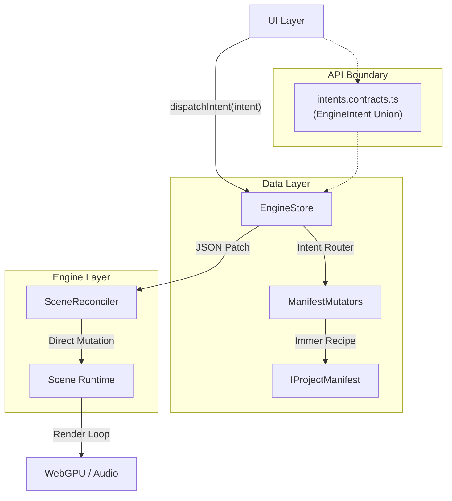
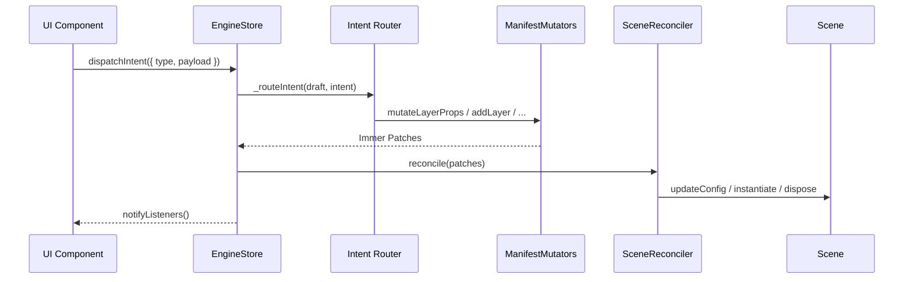
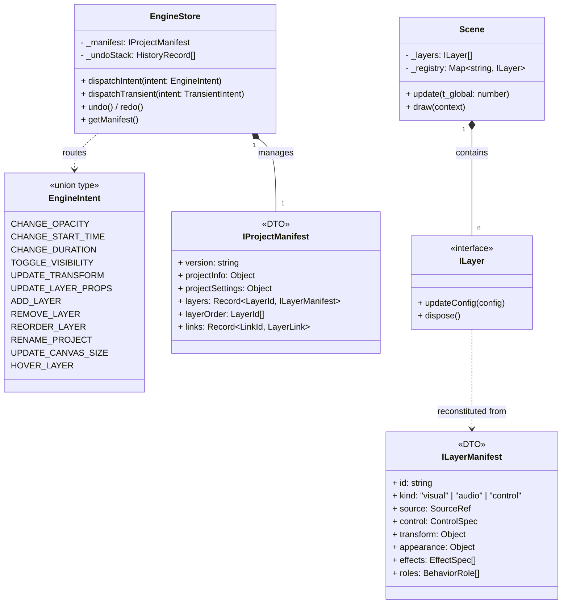
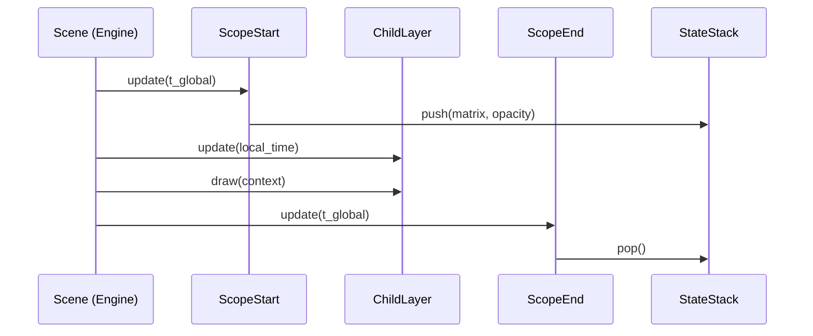

# Rendium Engine Technical Documentation

[English](../en/ARCHITECTURE.md)

본 문서는 **WebGPU 기반의 고성능 비선형 편집(NLE) 엔진인 Rendium**의 아키텍처 및 구현 사양을 기술합니다.

## 0. AI Onboarding Entry Points

레이어 모델, manifest 구조, runtime factory, visual render path를 변경하기 전에 `_docs/onboarding`의 모든 문서를 먼저 읽어야 합니다.

- `onboarding/README.md`: 현재 작업 문서의 읽기 순서와 우선순위.
- `onboarding/core-layer-onboarding.md`: 현재 핵심 레이어 계약, manifest, runtime factory, scope/link policy, AI 작업 체크리스트.
- `onboarding/visual-layer-provider-onboarding.md`: `VisualLayer + DrawableProvider` runtime 확장 규칙.

상세 규칙은 위 onboarding 문서가 우선합니다. `history-architecture`는 의사결정 배경과 과거 설계 기록을 보존하는 영역이며, 새 작업자가 따라야 할 최신 구현 규칙의 source of truth가 아닙니다.

---

## 1. 설계 철학 및 아키텍처 개요

### 1.1 Single Source of Truth (SSOT): Immutable Manifest
Rendium은 런타임 엔진(Scene)과 상태 관리소(Store)를 물리적으로 분리합니다. 모든 데이터의 원천은 **`IProjectManifest`**라는 순수 JSON 객체이며, 엔진은 이를 반영하는 **수동적 뷰(Passive View)**로 동작합니다.
*   **Normalized Project DTO**: manifest는 `projectInfo` / `projectSettings` / `layers` / `layerOrder` / `links`로 정규화되어 있습니다.
*   **Immutability**: 모든 상태 변이는 `EngineStore`를 통해 불변성(Immutability) 기반으로 제어됩니다.
*   **Patch-based Sync**: 상태 변화는 **JSON Patch**로 산출되며, 이를 통해 $O(1)$의 동기화 효율성과 완벽한 Undo/Redo 기능을 제공합니다.

### 1.2 Intent-Driven Architecture (의도 기반 아키텍처)
UI 계층과 엔진 내부를 완전히 분리하기 위해 **Intent-Driven 패턴**을 채택합니다.
*   **Contract**: 시스템이 허용하는 모든 사용자 액션은 `EngineIntent` 유니온 타입으로 정의됩니다 (`_contracts/intents.contracts.ts`).
*   **Dumb View**: UI 컴포넌트는 "무엇을(What)" 원하는지만 전달하며, "어떻게(How)" 상태를 변이할지는 알지 못합니다.
*   **Executable Specification**: TypeScript 컴파일러가 곧 검수자가 되어, Intent 인터페이스 자체가 절대 낡지 않는 기능 명세서 역할을 합니다.
*   **Automation Ready**: 자동화 매크로/AI 에이전트는 Intent 객체 배열을 엔진에 전달하는 것만으로 사용자 편집을 100% 에뮬레이트할 수 있습니다.

### 1.3 Unified Flat Architecture (플랫 저장, marker 해석)
엔진 코어 렌더링은 데이터의 평면성(Flatness)을 유지하여 성능을 최적화합니다.
*   **Bracket Structure**: `kind: "control"`과 `control.role: "scopeStart" | "scopeEnd"`는 저장 레이어로 유지하되, 의미적으로는 structure marker로 해석합니다.
*   **Root Scaffold**: root scaffold는 프로젝트 경계용 sentinel이며, 사용자 콘텐츠처럼 취급하지 않습니다.
*   **Derived Sequence**: `Sequence`는 별도 저장 엔티티가 아니라 `layers + layerOrder` 위에서 계산되는 논리적 wrapper입니다.
*   **성능**: 재귀 호출을 제거하고 $O(n)$ 반복문으로 렌더링을 처리하여 CPU 캐시 효율을 극대화합니다.

### 1.4 Project Info / Project Settings / Timeline Boundary
시간축에 종속되지 않는 값은 레이어가 아니라 `IProjectManifest`의 project-level 구조로 관리합니다.
*   **Project Info**: 문서 정체성은 `projectInfo`에 둡니다. 이름, 생성 시각, 수정 시각을 담습니다.
*   **Project Settings**: `projectSettings`는 렌더/캔버스/출력 관련 전역 설정입니다. `canvas.size`, `canvas.backgroundColor`, `watermark`, `exportRange`, `workArea`가 포함됩니다.
*   **Background Rendering**: 배경은 타임라인 레이어로 그리지 않고, render pass의 `clearValue` 또는 render surface 설정으로 처리합니다.
*   **Temporal Content Only**: `startTime`과 `duration`이 있는 것만 타임라인 레이어로 유지합니다. 화면 전체를 덮더라도 시간축에 종속되면 레이어입니다.
*   **Legacy Cleanup**: 과거의 `background` 전용 레이어/레코드는 폐기되었으며, 배경 인스펙터는 project settings 편집으로 대체되었습니다.

---

## 2. 엔진 시스템 아키텍처

### 2.1 아키텍처 다이어그램 (Intent-Driven Flow)



### 2.2 Intent 흐름 시퀀스



### 2.3 클래스 다이어그램 (Component Composition)



---

## 3. 상태 관리 및 동기화 메커니즘

### 3.1 정규화된 상태 구조 (Normalized State Shape)
데이터 무결성과 패치 효율을 위해 `IProjectManifest`는 다음 구조를 가집니다.
*   **Project Info**: `projectInfo`는 문서 정체성만 담습니다.
*   **Project Settings**: `projectSettings`는 캔버스/출력/배경/작업 영역 설정을 담습니다.
*   **Selector Boundary**: `EngineSelectors`는 UI snapshot과 viewport 중심으로 유지하고, sequence bounds / parent / insertion 계산은 `SequenceBoundsService`가 담당합니다.
*   **`layers` (Record)**: ID를 키로 하는 속성 저장소. 레이어의 추가/삭제가 다른 레이어의 패치 경로에 영향을 주지 않도록 유도합니다.
*   **`layerOrder` (Array)**: 렌더링 및 레이어 순서를 결정하는 유일한 배열.
*   **Derived Structure**: sequence bounds, parent sequence, insertion context는 저장하지 않고 계산합니다.

### 3.2 Intent-Driven Dispatch (의도 기반 디스패치)
UI 컴포넌트는 엔진 내부 구조(Immer draft, ManifestMutators)를 알 필요 없이, 순수 JSON 형태의 Intent 객체만 전달합니다.

```typescript
// UI에서 호출 (What만 전달)
dispatchIntent({ type: 'CHANGE_OPACITY', layerId: 'abc', opacity: 0.5 });

// 엔진 내부에서 처리 (How는 Intent Router가 결정)
// → mutateLayerProps(draft, 'abc', l => { l.appearance.opacity = 0.5 })
```

지원되는 Intent 타입:
| 카테고리 | Intent Types |
|---|---|
| Layer Properties | `CHANGE_OPACITY`, `CHANGE_START_TIME`, `CHANGE_DURATION`, `TOGGLE_VISIBILITY`, `UPDATE_TRANSFORM`, `UPDATE_LAYER_PROPS` |
| Layer Lifecycle | `ADD_LAYER`, `REMOVE_LAYER`, `REORDER_LAYER` |
| Project | `RENAME_PROJECT`, `UPDATE_CANVAS_SIZE` |
| UI-Only | `HOVER_LAYER` |
| Transient | `TRANSIENT_LAYER_UPDATE` (별도 union) |

### 3.3 SceneReconciler (동기화 엔진)
`EngineStore`에서 발생한 JSON Patch를 해석하여 런타임 엔진에 적용합니다.
*   **O(1) 접근**: 패치 경로에 포함된 ID를 기반으로 엔진 레지스트리에서 즉시 인스턴스를 찾아 수정합니다.
*   **자원 관리**: Reconciler는 레이어 제거 시 반드시 `dispose()`를 호출하여 GPU/Audio 자원 누수를 방지합니다.

### 3.4 Draft-Commit 패턴 (연속 조작 통제)
마우스 드래그와 같은 고빈도 인터랙션의 성능을 위해 2단계 업데이트를 수행합니다.
1.  **Transient Update**: `dispatchTransient({ type: 'TRANSIENT_LAYER_UPDATE', layerId, partial })`을 통해 엔진 인스턴스에만 즉시 값을 반영 (패치 및 히스토리 생성 안 함).
2.  **Commit**: 조작 종료 시 `dispatchIntent()`를 호출하여 최종 상태를 스토어에 기록하고 히스토리 스냅샷을 생성합니다.

---

## 4. 렌더링 및 시간 시스템

### 4.1 스택 기반 실행 시퀀스
렌더링 루프는 평면 배열을 순차 탐색하며 스택을 통해 속성을 전파합니다.



### 4.2 시간 계층 (Temporal Hierarchy)
모든 하위 요소는 부모의 시작점을 0으로 하는 상대적 시간 좌표계를 가집니다.
$t_{local, i} = t_{parent} - startTime_{i}$

---

## 5. 기술 사양 (Specs)

*   **Coordinate System**: 1920x1080 논리적 픽셀 공간.
*   **WebGPU Alignment**: Uniform 버퍼 256바이트 정렬 준수.
*   **Audio Pipeline**: 비동기 로딩 및 `AbortController` 기반의 수명 주기 관리.
*   **API Boundary**: `intents.contracts.ts` — UI↔Engine 간 유일한 계약 경계.
*   **Canvas Background**: 프로젝트 배경은 별도 레이어가 아니라 `projectSettings.canvas.backgroundColor`를 사용한 clear 단계로 처리합니다.

---

## 6. 아키텍처 히스토리

### 6.1 전역 캔버스 속성 마이그레이션
배경과 캔버스 전역 속성을 레이어에서 분리한 결정은 아래 ADR에 기록했습니다.
*   [ADR 007: Global Canvas Attributes Migration](../history-architecture/ko/007-global-canvas-attributes-migration.md)

### 6.2 Project Info / Settings 및 Sequence Bounds 정리
`meta`와 흩어진 전역 필드를 `projectInfo` / `projectSettings`로 정리하고, sequence 해석 책임을 `SequenceBoundsService`로 분리한 기록은 아래 히스토리에 남겼습니다.
*   [ADR 008: Project Info, Settings, and Sequence Bounds Refactor](../history-architecture/ko/008-project-info-settings-sequence-bounds-refactor.md)
